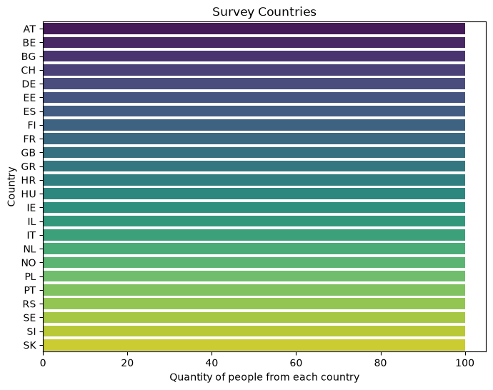
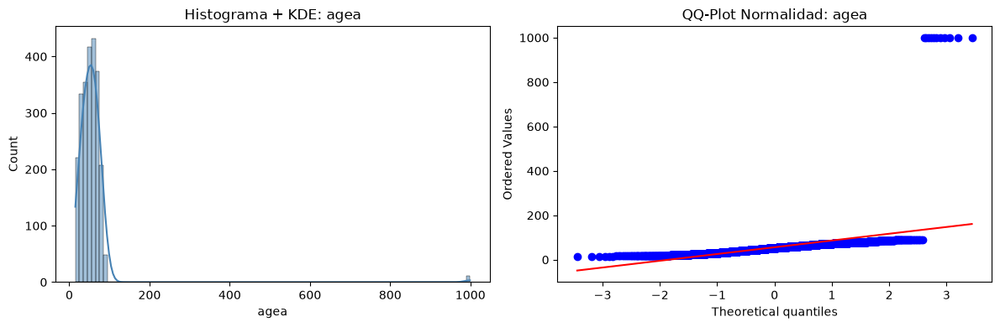
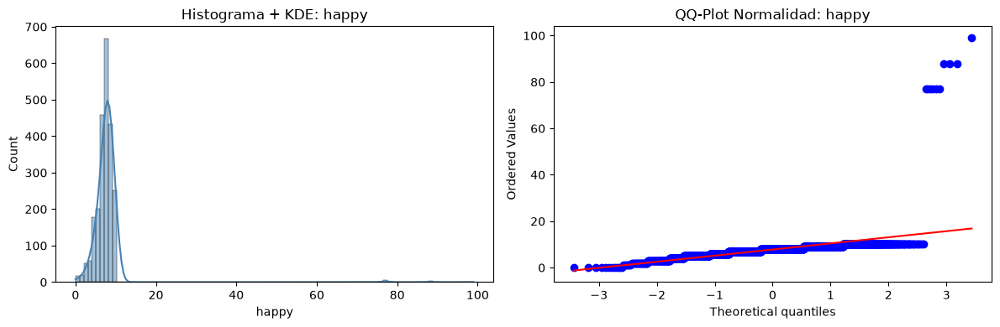

🟢 < Module 6.2 > Statistical Profiling, Variable Typologies & Transformation Techniques(Pre-EDA)

I considered to put this excercise after Data cleaning because is the previous step before making the EDA.
I added it on Module 4 on Readme.md index because it belongs realisticly to that concept area.

##### 🎯 Context & Objectives

Data cleaning alone is not enough to prepare a dataset for modeling; a Data Scientist must understand the mathematical and structural nature of every feature. In this module, you will formally classify variables into **continuous, discrete, multinomial ordinal, and categorical**, master the transformation techniques required to bridge them (e.g., discretizing continuous metrics into ordinal bins, factorizing ordinal Likert scales into categorical classes, or mapping structural features), **apply standardization and rescaling transformations to continuous variables, and implement outlier detection and treatment strategies to ensure robust modeling inputs**. You will also build basic distribution visualizations to inspect skewness, modality, variance, **and tail behavior** before feature engineering.

##### 📑 Exercise Instructions

###### 1. Syntactic / Algorithmic Level (Variable Typology & Transformation Functions)

Create a Python notebook (`notebooks/06_2_variable_profiling_transformations.ipynb`) that implements the following technical steps:

- **Variable Typology Definition & Profiling**:
    
    - Classify the project variables (`emplrel`, `edulvlb`, `emplno`, `happy`, `lrscale`, `cntry`, `EmployType`) into their exact statistical types: _Continuous_, _Discrete/Count_, _Multinomial Ordinal_, and _Nominal/Categorical_.
        
    - Compute statistical profiling metrics (mean, median, standard deviation, IQR, skewness, **kurtosis**, and unique value counts) for each category.
        
- **Transformation & Discretization Techniques**:
    
    - _Ordinal to Categorical / Binning:_ Use `pd.cut()` or `pd.qcut()` to transform 11-point ordinal scales (e.g., `happy` or `lrscale`) into structured categorical tiers (e.g., Low, Medium, High).
        
    - _Factorization & Mapping:_ Implement `pd.factorize()` and explicit `.map()` dictionaries to convert categorical text columns or custom groupings (like `EmployType`) into clean integer codes without breaking ordinal hierarchies.
        
- **Continuous Variable Transformations**:
    
    - _Rescaling & Standardization:_ Apply **min-max normalization** (`(x - min) / (max - min)`), **z-score standardization** (`(x - mean) / std`), and **log transformation** (`np.log1p()`) to continuous/count variables (e.g., `emplno`, `agea`). Document which transformation is appropriate for each variable type and distribution shape.
        
    - _Monotonic & Non-monotonic:_ Implement **Box-Cox** (`scipy.stats.boxcox`) and **Yeo-Johnson** (`scipy.stats.yeojohnson`) transformations for positively-skewed continuous features. Compare their effect on skewness and kurtosis before and after.
        
    - _Continuous to Discrete (Binning):_ Apply `pd.qcut()` (quantile-based) and `pd.cut()` (fixed-width) to a continuous variable (e.g., `emplno` or `agea`) to create ordinal bins. **Justify the choice of bin edges** (equal-frequency vs. equal-width vs. domain-informed) and document how the binning decision affects downstream model interpretability.
        
- **Outlier Detection & Treatment**:
    
    - _Detection:_ Implement at least **two** outlier detection methods:
        
        1. **IQR method:** Flag observations outside `[Q1 - 1.5×IQR, Q3 + 1.5×IQR]`.
            
        2. **Z-score / Modified Z-score:** Flag observations with `|z| > 3` (or `|modified z| > 3.5` using the MAD-based robust z-score).
            
    - _Treatment:_ For each detected outlier, apply and compare:
        
        1. **Removal:** Drop the observation.
            
        2. **Winsorization (clipping):** Cap values at the 1st and 99th percentiles (`np.clip`).
            
        3. **Imputation:** Replace with the group median (e.g., by `EmployType` or `std_region`).
            
    - _Decision criteria:_ Document **when** each treatment is appropriate (e.g., removal for data entry errors, winsorization for heavy-tailed legitimate variation, imputation for structural missingness). **Never remove outliers without first verifying they are not legitimate observations** (e.g., a self-employed respondent with 400 employees is not an outlier — it is a valid data point).
        

###### 2. Applied / Data Level (Visualizing Distributions & Structural Shifts)

- **Distribution Visualization**:
    
    - Create basic distribution plots (using Matplotlib / Seaborn histograms, KDE curves, and countplots) for key variables like `edulvlb` and `emplno`.
        
    - Visually inspect how the point mass at `0` for wage earners in `emplno` alters the distribution shape compared to self-employed cohorts.
        
    - **Create boxplots (or violin plots) segmented by `EmployType` or `std_region` to visually identify outliers and distributional shifts across subgroups.**
        
- **Transformation Impact Assessment**:
    
    - Compare the descriptive statistics of a variable before and after applying a transformation (e.g., raw 0–10 scale vs. 3-class factorized ordinal; raw `emplno` vs. log-transformed `emplno`). Document when it is mathematically appropriate to treat an ordinal variable as continuous versus categorical.
        
    - **For continuous transformations (log, Box-Cox, z-score): plot the original and transformed distributions side-by-side. Report the change in skewness and kurtosis as a quantitative measure of transformation effectiveness.**
        
- **Outlier Impact Assessment**:
    
    - **Before/after comparison:** For each outlier treatment strategy (removal, winsorization, imputation), report:
        
        - Change in mean, std, IQR, and skewness of the affected variable.
            
        - Number of observations affected (removed, clipped, imputed).
            
        - Visual overlay: original distribution (gray) vs. treated distribution (colored) on the same axis.
            
    - **Decision table:** Summarize in a table which treatment was applied to which variable, how many outliers were affected, and the resulting change in key statistics. Justify the choice per variable.
        

##### 🌐 Official References & Documentation

- **Pandas Categorical Data Guide:** Pandas Working with Categoricals
    
- **Seaborn Distribution Plots:** Seaborn Histplot & KDE Guide
    
- **Scipy Statistical Transformations:** scipy.stats.boxcox & yeojohnson
    

##### 📚 Recommended Manuals & CheatSheets

- **DataCamp Pandas Cheat Sheet:** Pandas Data Manipulation & Transformation
    
- **Statistical Data Types in Machine Learning:** Feature Engineering for Machine Learning (Book Overview)
    
- **Outlier Detection Methods:** [IQR vs. Z-Score vs. Isolation Forest — Comparison](https://towardsdatascience.com/outlier-detection-methods-5749d52d2703)
    

💻 **Your Challenge:** Create the notebook `notebooks/06_2_variable_profiling_transformations.ipynb`, build the statistical profiling summary table, apply the transformation techniques (binning, factorization, **log/Box-Cox, z-score**), **detect and treat outliers with documented justification**, generate the distribution plots for your cleaned dataset, **and produce the before/after comparison tables for both transformations and outlier treatments**. ¡Cuando estés listo, comparte tus resultados o código aquí para revisarlo! 🚀📊


```python
from pathlib import Path
import os
import pandas as pd
import random
#PATHING SCRIPT FOR EVERY EXCERSISE - PROJECT - WORKSPACE
# 1.Literal definition of route pathings(Every user of remote repository must config this pathing in order to find the local repository of his computer)
# My case:
ROOT = Path("/home/josu/Documentos/DataScienceCourse")

# We verify the existence before continue
if not ROOT.exists():
    raise FileNotFoundError(f"❌ The route {ROOT} doesn't exist. Check it.")

# 2. Fix the workspace
os.chdir(ROOT)
print(f"✅ Worskspace enabled!: {os.getcwd()}")

# 3. Define relative pathings to work properly
DATA_TABLES = ROOT / "data" / "raw" / "Tables"

# Let's verify our table folder:
if not DATA_TABLES.exists():
    # If it fails, monitorize the issue: 
    data_dir = ROOT / "data"
    if data_dir.exists():
        print(f"⚠️ the folder 'data' exists but it doesn't have any 'Tables'. 'data' content: {os.listdir(data_dir)}")
    else:
        print(f"⚠️ The folder 'data' doesn't exist on ROOT workspace: {os.listdir(ROOT)}")
    raise FileNotFoundError(f"❌ The tables route {DATA_TABLES} is missing.")

print(f"📂 Tables route detected: {DATA_TABLES}")

```

    ✅ Worskspace enabled!: /home/josu/Documentos/DataScienceCourse
    📂 Tables route detected: /home/josu/Documentos/DataScienceCourse/data/raw/Tables


```python
import duckdb as db
from dotenv import load_dotenv

load_dotenv()

# Initialize DuckDB connection
con = db.connect()
con.execute("INSTALL postgres; LOAD postgres;")

attach_query = f"""
ATTACH IF NOT EXISTS 'dbname={os.getenv("PGDATABASE")} 
        user={os.getenv("PGUSER")} 
        password={os.getenv("PGPASSWORD")} 
        host={os.getenv("PGHOST")} 
        port={os.getenv("PGPORT")}' 
AS db (TYPE postgres);
"""
con.execute(attach_query)

#Lets prepare a sample dataframe for this excercise
#First of all lets check the rows for every unique value of country and
#Decide how many samples we can get.
print(con.execute("""
    SELECT cntry, COUNT(*) AS n
    FROM db.surveys
    WHERE COLUMNS(*) IS NOT NULL
    GROUP BY cntry
    ORDER BY cntry
""").df())

```

       cntry     n
    0     AT  2197
    1     BE  1406
    2     BG  1919
    3     CH  1226
    4     DE  2253
    5     EE  1150
    6     ES  1635
    7     FI  1518
    8     FR  1592
    9     GB  1561
    10    GR  2389
    11    HR  1377
    12    HU  1925
    13    IE  1807
    14    IL   783
    15    IT  2485
    16    NL  1606
    17    NO  1238
    18    PL  1292
    19    PT  1262
    20    RS  1367
    21    SE  1084
    22    SI  1115
    23    SK  1312


```python
# 100 rows per country is sufficient for this exercise.
# It affects the analysis (reduced sample size) but not the methodology.

# DuckDB's main advantage here: seamless SQL → Pandas bridge.
# We write a SQL query, get a DataFrame, and chain Pandas methods directly.
#
# Simple example (global random sample):
#   df = con.execute("SELECT ... FROM db.surveys WHERE COLUMNS(*) IS NOT NULL") \
#            .df().sample(n=5000, random_state=42).reset_index(drop=True)
#
# For this case we need a stratified sample: 100 rows per country,
# reproducible via random_state, balanced across all 24 countries.

df_raw = con.execute("""
    SELECT emplno, agea, emplrel, edulvlb, happy, lrscale, cntry, EmployType
    FROM db.surveys
    WHERE COLUMNS(*) IS NOT NULL
""").df()

df_62 = pd.concat([
    g.sample(n=min(100, len(g)), random_state=42)
    for _, g in df_raw.groupby('cntry')
]).reset_index(drop=True)

print(f"Shape: {df_62.shape}")  # → (2400, 8)
del df_raw   
```

    Shape: (2400, 8)

1. Syntactic / Algorithmic Level (Variable Typology & Transformation Functions)
Create a Python notebook (notebooks/06_2_variable_profiling_transformations.ipynb) that implements the following technical steps:

1.1 Variable Typology Definition & Profiling:

A) Classify the project variables (emplrel, edulvlb, emplno, happy, lrscale, cntry, EmployType) into their exact statistical types: Continuous, Discrete/Count, Multinomial Ordinal, and Nominal/Categorical.

B) Compute statistical profiling metrics (mean, median, standard deviation, IQR, skewness, kurtosis, and unique value counts) for each category.

```python
#1.1.A) Classify the project variables (emplrel, edulvlb, emplno, happy, lrscale, cntry, EmployType) 
#into their exact statistical types: Continuous, Discrete/Count, Multinomial Ordinal, and Nominal/Categorical.
# The easiest way is make 2 functions to analyze variables. But we gona make one of them manually to understand
# The process:
# Lets classify the variables with select_dtypes instruction:
import pandas as pd
import numpy as np
num_cols = df_62.select_dtypes(include=['int64', 'float64']).columns.tolist()
cat_cols = df_62.select_dtypes(include=['str']).columns.tolist()
#We can also use df.info() instruction for fast checking of this.
print(num_cols,"\n",cat_cols)


```

    ['emplno', 'agea', 'emplrel', 'edulvlb', 'happy', 'lrscale'] 
     ['cntry']


```python
# Lets do an exhaustive analisys about "cntry" column. is the only one categorical
# because in this data set about surveys, every categorical value from binaries or ordinal
# are already factorized in to digits as likert scales.
# So our mission is inspect cntry variable and factorize and include them to numerical columns.
# as every categorical, this column is discrete. We can also check
# looking on counts,unique values, unique value counts comparing it to the variable range.
print(df_62['cntry'].count(),"Samples/Rows\n",
      df_62['cntry'].nunique(),"Unique values\n",
      df_62['cntry'].value_counts(),"Quantity of rows of unique values\n",
      df_62['cntry'].isna().sum(),"Quantity of Null values")
#We can also use df_62['cntry'].describe() for more usefull information.


```

    2400 Samples/Rows
     24 Unique values
     cntry
    AT    100
    BE    100
    BG    100
    CH    100
    DE    100
    EE    100
    ES    100
    FI    100
    FR    100
    GB    100
    GR    100
    HR    100
    HU    100
    IE    100
    IL    100
    IT    100
    NL    100
    NO    100
    PL    100
    PT    100
    RS    100
    SE    100
    SI    100
    SK    100
    Name: count, dtype: int64 Quantity of rows of unique values
     0 Quantity of Null values


```python
#Lets check the main metrics of country and explain them.
df_62['cntry'].describe()
```


    count     2400
    unique      24
    top         AT
    freq       100
    Name: cntry, dtype: object


```python
#For being a categorical variable and stratified , our describe doesnt give to much information
#Lets plot it and get more information:
import matplotlib.pyplot as plt
import seaborn as sns

# 1. Sort and calculate frecuencies
counts = df_62['cntry'].value_counts().reset_index()
counts.columns = ['cntry', 'count']

plt.figure(figsize=(8, 6))
# 2. Swap the axis being Y axis the country codes and X the number of rows.
sns.barplot(data=counts, x='count', y='cntry', palette='viridis', legend=False)

plt.title('Survey Countries')
plt.xlabel('Quantity of people from each country')
plt.ylabel('Country')
plt.show()
```

    /tmp/ipykernel_10092/425579281.py:12: FutureWarning: 
    
    Passing `palette` without assigning `hue` is deprecated and will be removed in v0.14.0. Assign the `y` variable to `hue` and set `legend=False` for the same effect.
    
      sns.barplot(data=counts, x='count', y='cntry', palette='viridis', legend=False)


    

    

As we can see on the plot, this column of the dataset is already balanced,
if we plot it with the number of samples as Y axis , it would draw
a plane line.


```python
# To end this example, lets factorize ´cntry'column, then we will use 2 functions for analyze every column
# in a easyer way.
df_62['cntry_fc'], x = pd.factorize(df_62['cntry'])
print(df_62['cntry_fc'].unique())
```

    [ 0  1  2  3  4  5  6  7  8  9 10 11 12 13 14 15 16 17 18 19 20 21 22 23]


```python
# Well as you can see our new variable stores country codes in a number list.
# In the apparition order.
# Lets get a deep analisis for every variable with our own function.
# You can check this function on src/descriptive_tools.py
from src import ds3on1
ds3on1(df_62, 'emplno', Desc=True, Stat=True, Graph=True)

```

    🌟 ANÁLISIS 3-EN-1: [EMPLNO] 🌟
    
    --------------------------------------------------
    📖 1. DESCRIPCIÓN
    --------------------------------------------------
      Familia estadística : NUMERIC
      Subtipo detectado   : DISCRETE_COUNT
      Detalle             : range 0-100, 24 values
    
    --------------------------------------------------
    🧮 2. ESTADÍSTICAS Y DIAGNÓSTICO
    --------------------------------------------------
    
      [numeric/discrete_count]  (n=2400, nulls=0)
      Media: 0.2863 | Mediana: 0.0000
      Q1/Q3: 0.0000 / 0.0000 | IQR: 0.0000
      Min/Max: 0.0000 / 100.0000
      % ceros (masa puntual): 96.17%
      ⚠️  WARNING: >50% de los valores son 0. Considera transformación log1p() si usas modelos lineales.
    
    --------------------------------------------------
    📊 3. VISUALIZACIÓN ADAPTATIVA
    --------------------------------------------------


    

    

'emplno', is a variable that registers in integer numbers how many workers you have or you had,
on discrete integers numbers. We can try about to transform it
in to logaritmic or make a cut for classify the sample.
More than 96% of the interviewed belongs to the main class (they have 0 persons working for them.
We can also adapt the integer values with a more common scale using log1p, so we minimize the impact in the dataset.
In my opinion i would cut this variable and make an ordinal with 3 factorized values.
for 0 values will be 0(employers or self-employers), from 1 to 10 (micro-enterprise)
and the last class would be with 11 workers or more.

```python
print(df_62['emplno'].value_counts())
```

    emplno
    0      2308
    1        39
    2        19
    3         5
    6         5
    5         3
    12        3
    8         2
    16        1
    48        1
    11        1
    10        1
    50        1
    7         1
    25        1
    4         1
    21        1
    100       1
    14        1
    60        1
    80        1
    15        1
    9         1
    28        1
    Name: count, dtype: int64


```python
#The best solution is binning the variable in to 3 labels:
import numpy as np

df_62['emplno_3ord'] = pd.cut(
    df_62['emplno'],
    bins=[-1, 0, 10, np.inf],
    labels=[0, 1, 2]
) # Where 0 is normal employer, 
  # selfemployed with 0 workers, 1 the entity with 1 worker to 10.
  # And the last class is who have 11 or more workers by his own. 
```


```python
print(df_62['emplno_3ord'].value_counts())
```

    emplno_3ord
    0    2308
    1      77
    2      15
    Name: count, dtype: int64


```python
#Lets make a quick analysis for the rest of the columns:
#['agea','emplrel','edulvlb','happy','lrscale','EmployType']
ds3on1(df_62, 'agea', Desc=True, Stat=True, Graph=True)
    
```

    🌟 ANÁLISIS 3-EN-1: [AGEA] 🌟
    
    --------------------------------------------------
    📖 1. DESCRIPCIÓN
    --------------------------------------------------
      Familia estadística : NUMERIC
      Subtipo detectado   : DISCRETE_COUNT
      Detalle             : range 15-999, 77 values
    
    --------------------------------------------------
    🧮 2. ESTADÍSTICAS Y DIAGNÓSTICO
    --------------------------------------------------
    
      [numeric/discrete_count]  (n=2400, nulls=0)
      Media: 56.0400 | Mediana: 53.0000
      Q1/Q3: 37.0000 / 66.0000 | IQR: 29.0000
      Min/Max: 15.0000 / 999.0000
      % ceros (masa puntual): 0.00%
    
    --------------------------------------------------
    📊 3. VISUALIZACIÓN ADAPTATIVA
    --------------------------------------------------


    

    


```python
#In this case we have interviewed ppl who refused to say his age so we have to eliminate
#as Ess surveys determine, there is 666,777,888, and 999 codes for this, we should clip
#or just delete rows with this values.
#The mean rounds up aprox on 56 years and median tell us the point
#where the 50% of samples are in of IQR range.
#Our data is poissoned with the positive outliers
#lets quit them from the dataset.

df_62['agea'] = df_62['agea'].replace([15,16,17,666, 777, 888, 999], np.nan)
df_62 = df_62.dropna(subset=['agea'])

print(df_62['agea'].describe(),'\nMode:',df_62['agea'].mode(),"\nMedian",df_62['agea'].median())
```

    count    2348.000000
    mean       52.316865
    std        17.923763
    min        18.000000
    25%        38.000000
    50%        53.000000
    75%        66.000000
    max        90.000000
    Name: agea, dtype: float64 
    Mode: 0    58.0
    Name: agea, dtype: float64 
    Median 53.0


```python
# Now the mean is less, but anyways the mode is stil 58 years
# wich means the most common age of intervieweds are quite old.
# The IQR range tell us the 50% of the samples are located in 66years-38years range(28 years)
# Also means the or unction has longer left tail than right(Negative Skewness).
# Depending on our target and the nature of our data we can normalize the numbers
# Or just binning the age range to make 3 classes.
# In my case ill do a logical binning {(0:18-35),(1:36-55),(2:56+)}
df_62['agea_3ord'] = pd.cut(
    df_62['agea'],
    bins=[17, 35, 55, np.inf],
    labels=[0, 1, 2]
)
print(df_62['agea_3ord'].value_counts(),'\n',df_62['agea_3ord'].describe())
```

    agea_3ord
    2    1063
    1     771
    0     514
    Name: count, dtype: int64 
     count     2348
    unique       3
    top          2
    freq      1063
    Name: agea_3ord, dtype: int64


```python
#We did a deep analisis of some of this variables, we made a outlier cleaning that was disturbing our metrics
#Also we factorized and binned some of the variables, making a brief analisis about the meaning of the metrics and shape
#of the data distribution.
#In my opinion in this dataset the only usefull transformation about making continuos or shaping it with some
#of the numerical capabilities like min-max, Log1p etc.
#Would be on the target variable, because there is a posibility that a linear regresion
#Can detect not only the predicted variable, also the expected range of the target
#Variables like happy or lrscale could be transformed, due his intensity grade
#explicit on its likert scale.
#Lets try with 'happy' variable, first of all we need a brief analisis about its metrics and shape.
from src import ds3on1
ds3on1(df_62, 'happy', Desc=True, Stat=True, Graph=True)
```

    🌟 ANÁLISIS 3-EN-1: [HAPPY] 🌟
    
    --------------------------------------------------
    📖 1. DESCRIPCIÓN
    --------------------------------------------------
      Familia estadística : NUMERIC
      Subtipo detectado   : DISCRETE_COUNT
      Detalle             : range 0-99, 14 values
    
    --------------------------------------------------
    🧮 2. ESTADÍSTICAS Y DIAGNÓSTICO
    --------------------------------------------------
    
      [numeric/discrete_count]  (n=2348, nulls=0)
      Media: 7.8066 | Mediana: 8.0000
      Q1/Q3: 7.0000 / 9.0000 | IQR: 2.0000
      Min/Max: 0.0000 / 99.0000
      % ceros (masa puntual): 0.47%
    
    --------------------------------------------------
    📊 3. VISUALIZACIÓN ADAPTATIVA
    --------------------------------------------------


    

    


```python
#This variable needs a data cleaning, there are non valid responses as outliers on this column.
df_62['happy'].value_counts()
```


    happy
    8     668
    7     458
    9     433
    10    252
    6     202
    5     178
    4      59
    3      52
    2      19
    0      11
    1       6
    77      6
    88      3
    99      1
    Name: count, dtype: int64


```python
df_62['happy'] = df_62['happy'].replace([77,88,99], np.nan)
col=df_62['happy']
def quick_stats(col):
    mode = col.mode()
    return pd.Series({
        'count':  col.count(),
        'mean':   col.mean(),
        'std':    col.std(),
        'min':    col.min(),
        'Q1':     col.quantile(.25),
        'median': col.median(),
        'Q3':     col.quantile(.75),
        'max':    col.max(),
        'mode':   mode[0] if not mode.empty else np.nan,
        'skew':   col.skew(),
        'kurtosis': col.kurt(),
    }) 
print(quick_stats(col))
```

    count       2338.000000
    mean           7.487169
    std            1.805724
    min            0.000000
    Q1             7.000000
    median         8.000000
    Q3             9.000000
    max           10.000000
    mode           8.000000
    skew          -1.051942
    kurtosis       1.531976
    dtype: float64


```python
#As we can see on the iqr range, kurtosis and skewness, the 75% of the samples are between 7 and 10, just the 25% of the samples
#Are located from 0 to 7 range. Too low sampledispersion around mode value with a bit more density around 7.5 than 9. the left tail is so long
#and right is too short, as skewness tell us, also this high number of kurtosis tell us about the sharpness of the mountain located near mode.
#for this kind of function we have to select a continuous transform.
#In my opinion the best transform here is the logit,
#log((y + ε) / (10 − y + ε)), ε≈0.5
#This because our mayor part of samples are compressed betwen 7 and 10 happy range value.
#This method adds an amplification on the range , is not uniform, it goes higher when the range value is close to the min max.
def logit_transform(col, max_val, eps=0.5):
    return np.log((col + eps) / (max_val - col + eps))

df_62['happy_logit'] = logit_transform(df_62['happy'], max_val=10)

df_62['happy_logit'].describe()
```


    count    2338.000000
    mean        1.145484
    std         0.975988
    min        -3.044522
    25%         0.762140
    50%         1.223775
    75%         1.845827
    max         3.044522
    Name: happy_logit, dtype: float64


ON this exercise we changed the objectives in the momment we saw,
making z-scores or contiunous transform werent the best soultion about the needs
of our dataset data, instead we binned some of the numerical continous variables
and we transformed an ordinal and possible target variable to continuous
taking into account the shape and distribution of the samples. There is hight chances
to get better prediction scores with special linear regressions with
Logit and OLS, or Beta regression in this case.