```python
------------------------------------------------------------------------------------------------------------
DataScienceCourse/
├── notebooks/
│   ├── 00_template.ipynb           # Template, for copying and having relative paths functional.
│   ├── 01_limpieza_grupo1.ipynb
│   └── 05_eda_analisis.ipynb
├── src/
│   ├── __init__.py
│   ├── paths.py                    # Pathing Setup script
│   └── descriptive_tools.py        # Script datascience ds3on1, vartype, statsgroup
└── main.py                         # Entry point for the scripts./
        "ROOT": ROOT_DIR,
        "DATA": DATA_DIR,
        "TABLES": TABLES_DIR,
        "PROCESSED": PROCESSED_DATA_DIR

------------------------------------------------------------------------------------------------------------
```


```python
%load_ext autoreload
%autoreload 2

import sys
from pathlib import Path
import os

ROOT_DIR = Path.cwd().parent
if str(ROOT_DIR) not in sys.path:
    sys.path.append(str(ROOT_DIR))

from src import setup_workspace, query_to_df, ds3on1

# 1. Inicializar workspace y rutas
paths = setup_workspace()

# 2. Consultar directamente a PostgreSQL (vía DuckDB ATTACH)
#df = query_to_df("SELECT * FROM db.EuInfo;")

# 3. Análisis univariable 3-en-1
#ds3on1(df, 'happy', Desc=True, Stat=True, Graph=True)
```

    The autoreload extension is already loaded. To reload it, use:
      %reload_ext autoreload
    ✅ Workspace anclado en: /home/josu/Documentos/DataScienceCourse
    📂 Ruta de tablas verificada: /home/josu/Documentos/DataScienceCourse/data/raw/Tables


🟢 < Module 7.1 > Exploratory Data Analysis (EDA), Stratified Distributions & Correlation Diagnostics

##### 🎯 Context & Objectives

In Exploratory Data Analysis (EDA), the goal is not merely to compute global summary statistics, but to uncover structural patterns, cluster behaviors, and dependencies between predictors and target variables across different economic contexts. In this exercise, you will perform an advanced EDA on your cleaned master survey dataset (`surveys_clean` combined with macro features). You will analyze ordinal vs. continuous variable distributions, evaluate non-linear relationships, and construct stratified correlation heatmaps comparing different European country clusters (e.g., high-income vs. medium/low-income economic groups).

##### 📑 Exercise Instructions

###### 1. Syntactic / Algorithmic Level (Pandas & Seaborn EDA Fundamentals)

Create a Python notebook (`notebooks/07_1_exploratory_data_analysis.ipynb`) that implements the following technical steps:

- **Statistical Profiling & Distribution Metrics** :
    
    - Compute robust central tendency and dispersion metrics (median, IQR, mean, standard deviation) for key survey ordinals (e.g., `happy`, `lrscale`, `stfdem`) and engineered features (`EmployType`, `emplno`).
        
    - Identify skewness and modal concentrations (such as the point mass at `0` in `emplno` for wage earners).
        
- **Stratified Correlation Analysis (Spearman vs. Pearson)** :
    
    - Explain why **Spearman’s rank correlation** is theoretically superior to Pearson's correlation when analyzing ordinal Likert scales (0–10) in survey data.
        
    - Generate a correlation matrix and visualize it using a Seaborn heatmap (`sns.heatmap`), ensuring proper diverging colormaps and annotation of correlation coefficients.
        

###### 2. Applied / Data Level (Socio-Economic Stratification & Insights)

Evaluate how macroeconomic country clusters modulate individual behaviors:

- **Multi-Group Comparison** :
    
    - Group your dataset by country economic tiers or regional clusters (`cntgrp_fc` / `std_region`).
        
    - Compare the distribution of political ideology (`lrscale`) or institutional trust (`trstlgl`) across different economic clusters using boxplots or violin plots (`sns.boxplot` / `sns.violinplot`).
        
- **Insight Synthesis** :
    
    - Document 3 key empirical findings from your visualizations that support your core research hypothesis (e.g., how educational level `edulvlb` or employment relation `EmployType` shifts political or social trust distributions).
        

##### 🌐 Official References & Documentation

- **Seaborn Statistical Plots** : [Seaborn Heatmap & Distribution Tutorial](https://seaborn.pydata.org/generated/seaborn.heatmap.html)
    
- **Pandas Statistical and Descriptive Functions** : [Pandas Descriptive Statistics Guide](https://pandas.pydata.org/docs/reference/api/pandas.DataFrame.describe.html)
    

##### 📚 Recommended Manuals & CheatSheets

- **DataCamp Seaborn Cheat Sheet** : [Python Seaborn Data Visualization Cheat Sheet](https://www.datacamp.com/cheat-sheet/python-seaborn-cheat-sheet)
    
- **Exploratory Data Analysis Best Practices** : [Python for Data Analysis — Exploratory Data Analysis Chapter](https://wesmckinney.com/book/)
    

💻 **Your Challenge:** Create the notebook `notebooks/07_1_exploratory_data_analysis.ipynb` in your local environment, run the stratified descriptive statistics and correlation heatmaps, and share your code or key findings here when ready for review! 🚀📊


```python
#First of all lets load a sample dataframe for this excercise from the main Surveys table.
import duckdb as db
import os
from dotenv import load_dotenv
import pandas as pd
import numpy as np

load_dotenv()

pg_db = os.getenv("PGDATABASE")
pg_user = os.getenv("PGUSER")
pg_pass = os.getenv("PGPASSWORD")
pg_host = os.getenv("PGHOST")
pg_port = os.getenv("PGPORT")


con = db.connect()
    

con.execute("INSTALL postgres; LOAD postgres;")
    

attach_query = f"""
ATTACH IF NOT EXISTS 'dbname={pg_db} user={pg_user} password={pg_pass} host={pg_host} port={pg_port}' 
AS db (TYPE postgres);
"""
    

con.execute(attach_query)


df_raw = con.execute("""
    SELECT emplno, agea, emplrel, edulvlb, happy, lrscale, cntry, EmployType, trstprl, trstlgl
    FROM db.surveys
    WHERE COLUMNS(*) IS NOT NULL
""").df()

df_71 = pd.concat([
    g.sample(n=min(100, len(g)), random_state=42)
    for _, g in df_raw.groupby('cntry')
]).reset_index(drop=True)

print(f"Shape: {df_71.shape}")  # → (2400, 8)
del df_raw 
```

    Shape: (2400, 10)


```python
------------------------------------------------------------------------------------------------------------
Step 0, Problem framing:
-Research question:
 To what extent do regional location, national political-economic context, and country-specific factors explain variation in [variable social var] 
across European countries, 2004–2024?
-RQ1 (descriptive): How do [surveys_vars] vary across European regions and over time (2004–2024)?
-RQ2 (comparative): Is the variance in [variable social] between countries larger than the variance between regions within the same country?
-RQ3 (asociative): To what extent do national economic indicators (GDP per capita, unemployment, Gini) predict [surveys_vars] within and across countries?
-RQ4: Do European countries cluster more strongly by similarity in economic trend trajectories (2004–2024) than by national identity (political regime, 
cultural region, or historical bloc)?
------------------------------------------------------------------------------------------------------------
```


```python
#First of all lets do a quick univariate analysis.
#1)Univariate Data Inspection:

ds3on1(df_71, 'emplno', Desc=True, Stat=True, Graph=True)
```

    🌟 ANÁLISIS 3-EN-1: [EMPLNO] 🌟
    
    --------------------------------------------------
    📖 1. DESCRIPCIÓN
    --------------------------------------------------
      Familia estadística : NUMERIC
      Subtipo detectado   : DISCRETE_COUNT
      Detalle             : range 0-100, 24 values
    
    --------------------------------------------------
    🧮 2. ESTADÍSTICAS Y DIAGNÓSTICO
    --------------------------------------------------
    
      [numeric/discrete_count]  (n=2400, nulls=0)
      Media: 0.2875 | Mediana: 0.0000
      Q1/Q3: 0.0000 / 0.0000 | IQR: 0.0000
      Min/Max: 0.0000 / 100.0000
      % ceros (masa puntual): 96.08%
      ⚠️  WARNING: >50% de los valores son 0. Considera transformación log1p() si usas modelos lineales.
    
    --------------------------------------------------
    📊 3. VISUALIZACIÓN ADAPTATIVA
    --------------------------------------------------


    
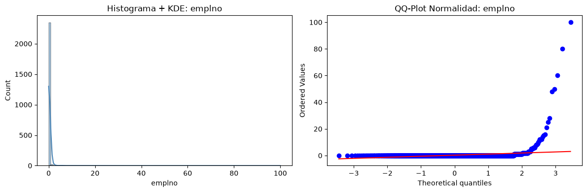
    


```python
------------------------------------------------------------------------------------------------------------
-emplno: – Number of employees the respondent has (self-employed only).  Discrete count, non-negative.
        -The distribution is zero-inflated: ~96% of respondents report 0 employees, reflecting that the vast majority are salaried workers, 
own-account self-employed, or not in the labour force. The non-zero values (1, 2, 5, 10, 25, 50+) represent a small subset of employers 
and are right-skewed with high kurtosis value(Leptokurtic. Almost all the proportion is located on 0 value).
        -Implication for analysis: this variable cannot be treated as a standard numeric variable. Options:
        -Create a binary indicator (is_employer: 0/1) for the RQs that care about whether someone employs.
        -For the subset of employers only, model the count separately (log-transform, or zero-inflated/negative binomial if modelling).
        -Do not use the raw count in a regression with the full sample — the 96% zeros will dominate and mask any signal.
------------------------------------------------------------------------------------------------------------
```


```python
ds3on1(df_71, 'agea', Desc=True, Stat=True, Graph=True)
```

    🌟 ANÁLISIS 3-EN-1: [AGEA] 🌟
    
    --------------------------------------------------
    📖 1. DESCRIPCIÓN
    --------------------------------------------------
      Familia estadística : NUMERIC
      Subtipo detectado   : DISCRETE_COUNT
      Detalle             : range 15-999, 77 values
    
    --------------------------------------------------
    🧮 2. ESTADÍSTICAS Y DIAGNÓSTICO
    --------------------------------------------------
    
      [numeric/discrete_count]  (n=2400, nulls=0)
      Media: 56.1200 | Mediana: 53.0000
      Q1/Q3: 37.0000 / 67.0000 | IQR: 30.0000
      Min/Max: 15.0000 / 999.0000
      % ceros (masa puntual): 0.00%
    
    --------------------------------------------------
    📊 3. VISUALIZACIÓN ADAPTATIVA
    --------------------------------------------------


    

    


```python
------------------------------------------------------------------------------------------------------------
-agea: – Age of the respondent. Discrete, non-negative integer.
        -Outliers / sentinel values: 666, 777, 888, 999 are non-response or data-entry error codes, not valid ages. They severely inflate the mean 
and must be excluded before any summary statistic is computed.
        -Distribution (after removing sentinels): Approximately symmetric, slightly right-skewed, with a median of ~53 years. 
The IQR spans 37–67, meaning half the sample is concentrated in a 30-year window. The tails under-represent young adults (18–36) and the oldest cohort (68+).
        -Implication: Age is a potential confounder for [variables sociales]. The concentration in 37–67 limits generalizability to younger 
and older populations. Any model that includes age as a covariate should use the median or a binned/categorical version rather than the raw (sentinel-inflated) value.
        -Cleaning decision: Remove sentinel codes (666, 777, 888, 999) and values < 18 (below survey eligibility per [source]).
------------------------------------------------------------------------------------------------------------
```


```python
ds3on1(df_71, 'emplrel', Desc=True, Stat=True, Graph=True)
```

    🌟 ANÁLISIS 3-EN-1: [EMPLREL] 🌟
    
    --------------------------------------------------
    📖 1. DESCRIPCIÓN
    --------------------------------------------------
      Familia estadística : CATEGORICAL
      Subtipo detectado   : NOMINAL
      Detalle             : 2 categories
    
    --------------------------------------------------
    🧮 2. ESTADÍSTICAS Y DIAGNÓSTICO
    --------------------------------------------------
    
      [categorical/nominal]  (n=2400, nulls=0)
    
      Top Valores:
        1                 2156  ( 89.8%)  ██████████████████████████████
        2                  244  ( 10.2%)  ███
      Únicos: 2
      ⚠️  WARNING: La categoría dominante supera el 50% de los datos.
    
    --------------------------------------------------
    📊 3. VISUALIZACIÓN ADAPTATIVA
    --------------------------------------------------


    /home/josu/Documentos/DataScienceCourse/src/descriptive_tools.py:203: FutureWarning: 
    
    Passing `palette` without assigning `hue` is deprecated and will be removed in v0.14.0. Assign the `y` variable to `hue` and set `legend=False` for the same effect.
    
      sns.barplot(x=vc.values, y=vc.index.astype(str), ax=axes[0], palette='Blues_r')


    
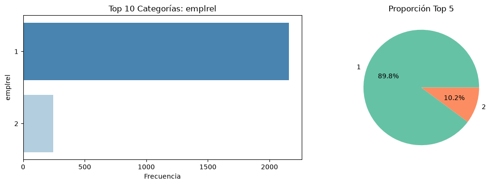
    


```python
------------------------------------------------------------------------------------------------------------
-emplrel: – Attends on wich type of job the respondent has. A factorized categorical variable, where 1 is all the respondents are wage employe and 2 self-employers or bussinessmen
          -The distribution is one inflated proportion, almost 90% of respondents are wage employers.
          -This variable it's totally derivated from emplno, and almost has the same distribution.
          -We can do the same method as 'emplno' or just omit it in the feature engineering.
------------------------------------------------------------------------------------------------------------
```


```python
ds3on1(df_71, 'edulvlb', Desc=True, Stat=True, Graph=True)
```

    🌟 ANÁLISIS 3-EN-1: [EDULVLB] 🌟
    
    --------------------------------------------------
    📖 1. DESCRIPCIÓN
    --------------------------------------------------
      Familia estadística : NUMERIC
      Subtipo detectado   : DISCRETE_COUNT
      Detalle             : range 0-9999, 29 values
    
    --------------------------------------------------
    🧮 2. ESTADÍSTICAS Y DIAGNÓSTICO
    --------------------------------------------------
    
      [numeric/discrete_count]  (n=2400, nulls=0)
      Media: 463.3138 | Mediana: 322.0000
      Q1/Q3: 313.0000 / 610.0000 | IQR: 297.0000
      Min/Max: 0.0000 / 9999.0000
      % ceros (masa puntual): 1.04%
    
    --------------------------------------------------
    📊 3. VISUALIZACIÓN ADAPTATIVA
    --------------------------------------------------


    
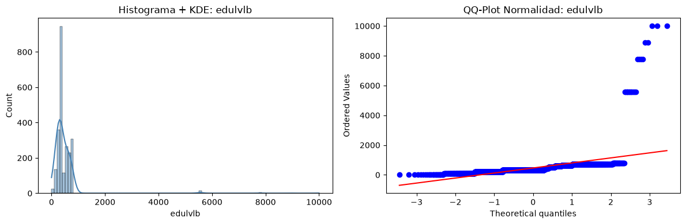
    


```python
------------------------------------------------------------------------------------------------------------
-edulvlb: – Education and profesional level of the respondent, ISCED codification . Discrete, non-negative ordinal value (the more qualification, higher code respondent has.).
          - Outliers / sentinel values: 6666, 7777, 8888, 9999 are non-response or data-entry error codes. Also there is a respondent minority class on 0 value, 
"ISCED 0 (early childhood / no formal education): ~1% of respondents"
          - Median observation tell us our frecuency or porportion is located with mayor mass in the Q2-Q3 range. We can observe an non high leptokurtosis and right-skewed distribution.          
          - The 50% of our mass fluctuates from 313(Q1)ISCED code to 610(Q3) code. This mas is located in 297(IQR) codification range.
          - This variable could be transformed in 3 or 4 categorical groups, also be binned in 3 variables in the case we need for the feature engineering.
------------------------------------------------------------------------------------------------------------                                                                  
```


```python
ds3on1(df_71, 'happy', Desc=True, Stat=True, Graph=True)
```

    🌟 ANÁLISIS 3-EN-1: [HAPPY] 🌟
    
    --------------------------------------------------
    📖 1. DESCRIPCIÓN
    --------------------------------------------------
      Familia estadística : NUMERIC
      Subtipo detectado   : DISCRETE_COUNT
      Detalle             : range 0-99, 14 values
    
    --------------------------------------------------
    🧮 2. ESTADÍSTICAS Y DIAGNÓSTICO
    --------------------------------------------------
    
      [numeric/discrete_count]  (n=2400, nulls=0)
      Media: 7.8204 | Mediana: 8.0000
      Q1/Q3: 7.0000 / 9.0000 | IQR: 2.0000
      Min/Max: 0.0000 / 99.0000
      % ceros (masa puntual): 0.46%
    
    --------------------------------------------------
    📊 3. VISUALIZACIÓN ADAPTATIVA
    --------------------------------------------------


    
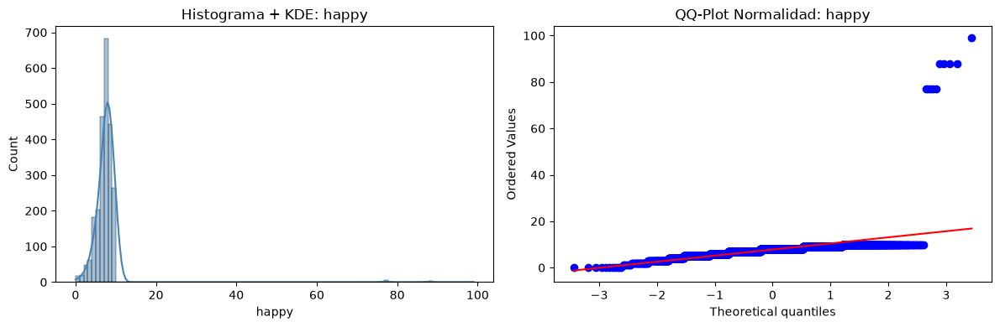
    


```python
------------------------------------------------------------------------------------------------------------
-happy: – State of happyness the respondent has, being 0 unhappy and 10 the max value on lickert scale. Discrete, non-negative ordinal value. 15 ordinal unique values
        - Outliers / sentinel values: 66, 77, 88, 99 are non-response or data-entry error codes.
        - The mean (7.8) is slightly below the median (8), consistent with the left skew: the thin tail of low-satisfaction responses (0–5) pulls the mean downward, while the median remains anchored in the central mass at 7–8.
        - The iqr range is so compressed, and the mean-median relation tells us in that 50% of mass respondents, respondents are more close to 8 value of happy than 7.
        - Implication: The limited dynamic range in the central mass makes the raw variable poorly discriminative for modelling.
        Options:
            -Binarize: satisfied = happy ≥ 8 (aligns with Eurostat's own "satisfied / not satisfied" split). Best if the RQ is "what predicts being satisfied?"
            -Categorical (3–4 groups): Unhappy (0–4), Neutral (5–6), Satisfied (7–8), Very satisfied (9–10). Best for ordinal regression (proportional odds).
            -Keep as interval (0–10): Defensible for OLS / random effects if you assume equal spacing. Best if the RQ is "what predicts the level of satisfaction?" and you want to use the full range.
        The choice depends on which RQ it serves. For RQ3 (economic predictors), the interval version preserves more information; for RQ4 (clustering), the categorical version is more robust.
------------------------------------------------------------------------------------------------------------
```


```python

col=df_71['cntry']
def quick_stats(col):
    mode = col.mode()
    return pd.Series({
        'count':  col.count(),
        'categories count': col.nunique(),
        'Uniques frecuency': col.value_counts(),
        #'mean':   col.mean(),
        #'std':    col.std(),
        'min':    col.min(),
        #'Q1':     col.quantile(.25),
        #'median': col.median(),
        #'Q3':     col.quantile(.75),
        'max':    col.max(),
        #'mode':   mode[0] if not mode.empty else np.nan,
        #'skew':   col.skew(),
        #'kurtosis': col.kurt()
    }) 
print(quick_stats(col))
#Being non factorized discrete categorical column, most of our metrics can't be used.
import matplotlib.pyplot as plt
import seaborn as sns
# 1. Sort and calculate frecuencies
counts = df_71['cntry'].value_counts().reset_index()
counts.columns = ['cntry', 'count']

plt.figure(figsize=(8, 6))
# 2. Swap the axis being Y axis the country codes and X the number of rows.
sns.barplot(data=counts, x='count', y='cntry', palette='viridis', legend=False)

plt.title('Survey Countries')
plt.xlabel('Quantity of people from each country')
plt.ylabel('Country')
plt.show()
```

    count                                                             2400
    categories count                                                    24
    Uniques frecuency    cntry
    AT    100
    BE    100
    BG    100
    CH    100
    ...
    min                                                                 AT
    max                                                                 SK
    dtype: object


    /tmp/ipykernel_99550/243739368.py:30: FutureWarning: 
    
    Passing `palette` without assigning `hue` is deprecated and will be removed in v0.14.0. Assign the `y` variable to `hue` and set `legend=False` for the same effect.
    
      sns.barplot(data=counts, x='count', y='cntry', palette='viridis', legend=False)


    

    


```python
------------------------------------------------------------------------------------------------------------
-cntry: – the string values (countries) are ordered in order of appearance, 
it is the variable that we have used to create the dataframe using grouping and maximum number of random samples.
------------------------------------------------------------------------------------------------------------
```


```python
ds3on1(df_71, 'lrscale', Desc=True, Stat=True, Graph=True)
```

    🌟 ANÁLISIS 3-EN-1: [LRSCALE] 🌟
    
    --------------------------------------------------
    📖 1. DESCRIPCIÓN
    --------------------------------------------------
      Familia estadística : NUMERIC
      Subtipo detectado   : DISCRETE_COUNT
      Detalle             : range 0-99, 14 values
    
    --------------------------------------------------
    🧮 2. ESTADÍSTICAS Y DIAGNÓSTICO
    --------------------------------------------------
    
      [numeric/discrete_count]  (n=2400, nulls=0)
      Media: 14.2346 | Mediana: 5.0000
      Q1/Q3: 4.0000 / 7.0000 | IQR: 3.0000
      Min/Max: 0.0000 / 99.0000
      % ceros (masa puntual): 3.21%
    
    --------------------------------------------------
    📊 3. VISUALIZACIÓN ADAPTATIVA
    --------------------------------------------------


    
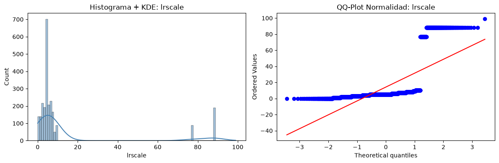
    


```python
------------------------------------------------------------------------------------------------------------
-lrscale: – Lickert Scale wich gives us information of the political ideology respondent was, 0 is comunism, and 10 far right extremism. Discrete, non-negative ordinal value. 15 ordinal unique values
          - Outliers / sentinel values: 66, 77, 88, 99 are non-response or data-entry error codes.
          - The mean is highly affected by positive outliers of non respondent values.
          - The median tells us that Q2 finishes and splits the graph at 5 value. The 50% of mass proportion its located between 4 and 7 (Q1/Q3), fluctuating on 3 discrete values(IQR).
The iqr tells us that those interviewed have a fairly standard political position, from social democracy to a non-conservative right-wing position.
          - In this case the shape is right-skewed, also  leptokurted on iqr range.
          Options:
            - Same case as 'Happy', 1- binarize left wing- Right wing, 2 - categorize in more groups to detect more clases for better for ordinal regression.
            - Make it continuous in the case we focus the problem as range prediction.
            - Keep this ordinal interval, assuming the inequality of proportion.
------------------------------------------------------------------------------------------------------------
```


```python
ds3on1(df_71, 'EmployType', Desc=True, Stat=True, Graph=True)
```

    🌟 ANÁLISIS 3-EN-1: [EMPLOYTYPE] 🌟
    
    --------------------------------------------------
    📖 1. DESCRIPCIÓN
    --------------------------------------------------
      Familia estadística : CATEGORICAL
      Subtipo detectado   : NOMINAL
      Detalle             : 2 categories
    
    --------------------------------------------------
    🧮 2. ESTADÍSTICAS Y DIAGNÓSTICO
    --------------------------------------------------
    
      [categorical/nominal]  (n=2400, nulls=0)
    
      Top Valores:
        1                 2156  ( 89.8%)  ██████████████████████████████
        2                  244  ( 10.2%)  ███
      Únicos: 2
      ⚠️  WARNING: La categoría dominante supera el 50% de los datos.
    
    --------------------------------------------------
    📊 3. VISUALIZACIÓN ADAPTATIVA
    --------------------------------------------------


    /home/josu/Documentos/DataScienceCourse/src/descriptive_tools.py:203: FutureWarning: 
    
    Passing `palette` without assigning `hue` is deprecated and will be removed in v0.14.0. Assign the `y` variable to `hue` and set `legend=False` for the same effect.
    
      sns.barplot(x=vc.values, y=vc.index.astype(str), ax=axes[0], palette='Blues_r')


    
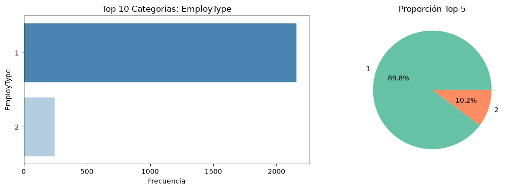
    


```python
------------------------------------------------------------------------------------------------------------
EmployType: We can discard this variable on EDA, it has same distribution and mass proportion than Emprel.
------------------------------------------------------------------------------------------------------------
```


```python
ds3on1(df_71, 'trstprl', Desc=True, Stat=True, Graph=True)
```

    🌟 ANÁLISIS 3-EN-1: [TRSTPRL] 🌟
    
    --------------------------------------------------
    📖 1. DESCRIPCIÓN
    --------------------------------------------------
      Familia estadística : NUMERIC
      Subtipo detectado   : DISCRETE_COUNT
      Detalle             : range 0-88, 13 values
    
    --------------------------------------------------
    🧮 2. ESTADÍSTICAS Y DIAGNÓSTICO
    --------------------------------------------------
    
      [numeric/discrete_count]  (n=2400, nulls=0)
      Media: 5.9504 | Mediana: 5.0000
      Q1/Q3: 2.7500 / 7.0000 | IQR: 4.2500
      Min/Max: 0.0000 / 88.0000
      % ceros (masa puntual): 11.50%
    
    --------------------------------------------------
    📊 3. VISUALIZACIÓN ADAPTATIVA
    --------------------------------------------------


    
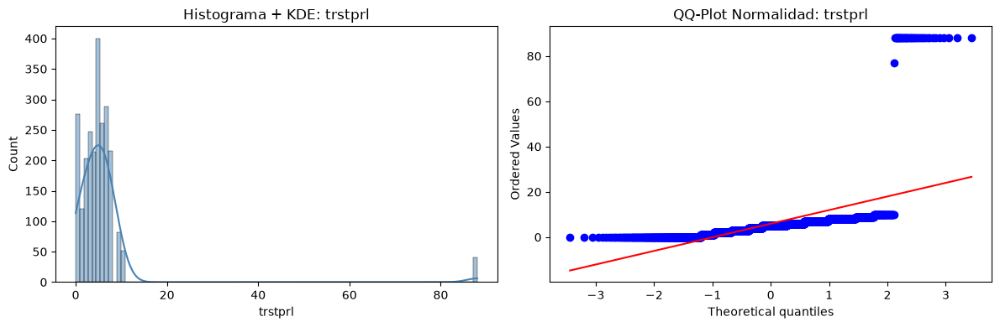
    


```python
------------------------------------------------------------------------------------------------------------
trstprl - Trust in country's ' parliament, Discrete, positive, ordinal lickert scale from 0 to 10, with non respondent values and non valid from 66 to 99. 15 ordinal unique values
        - We can observe in the distribution and shape the mass is very distributed on its range(slightly right skewed, and low kurtosis(the mass is balanced arround a wide range of variable values)), also the distribution is contaminated with the outliers that attends on non valid values (66,77,88,99), altering the shape and mean value. 
The 0 class has almost 12% of frecuency.
        - The 50% of respondent mass are distribuited in the almost half of variable range"4.25"/IQR, from 2.75/Q1 to 7/Q2
        - This column is very balanced, and also could be a good target variable. We can keep it as ordinal, binnarize or make categorical grouping.
        Options: We can binarize the column, aswell make categorical grouping or and especific continuous transformation.
------------------------------------------------------------------------------------------------------------
```


```python
 ds3on1(df_71, 'trstlgl', Desc=True, Stat=True, Graph=True)
```

    🌟 ANÁLISIS 3-EN-1: [TRSTLGL] 🌟
    
    --------------------------------------------------
    📖 1. DESCRIPCIÓN
    --------------------------------------------------
      Familia estadística : NUMERIC
      Subtipo detectado   : DISCRETE_COUNT
      Detalle             : range 0-88, 12 values
    
    --------------------------------------------------
    🧮 2. ESTADÍSTICAS Y DIAGNÓSTICO
    --------------------------------------------------
    
      [numeric/discrete_count]  (n=2400, nulls=0)
      Media: 6.8537 | Mediana: 6.0000
      Q1/Q3: 4.0000 / 8.0000 | IQR: 4.0000
      Min/Max: 0.0000 / 88.0000
      % ceros (masa puntual): 6.71%
    
    --------------------------------------------------
    📊 3. VISUALIZACIÓN ADAPTATIVA
    --------------------------------------------------


    
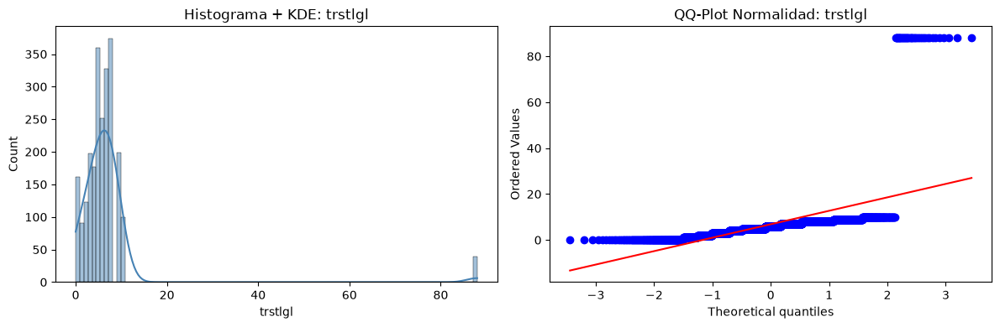
    


```python
------------------------------------------------------------------------------------------------------------
trstlgl - Trust in legal system. Discrete, positive, ordinal lickert scale, from 0 to 10, with non respondent/valid values from 66  to 99
        - Again the right skewed of the shape indicates a data contamination due non respondent/valid values located on 66-99 column values, 
we can observe aswell a bit kurtosis around the median, our mean is displaced due positive outliers density.
        - The 4/IQR range indicates a decent spread mass of the 50% of samples. almost centered in a logic response, low untrust "4"/Q1 and decent trust "8"/Q3
        Options: We can binarize the column, aswell make categorical grouping or and especific continuous transformation.
------------------------------------------------------------------------------------------------------------
```


```python
------------------------------------------------------------------------------------------------------------
2) Multivariate analysis — data preparation

A) Before proceeding, we clean the dataset of non-respondent codes (66, 77, 88, 99 for ordinal scales; 
6666, 7777, 8888, 9999 for continuous variables) detected per column. Each occurrence is recorded in a new integer column n_nonresp, 
counting how many non-valid responses each respondent gave across the trust variables.

B) The resulting missing values are then imputed via random hot-deck: each missing value is drawn from the empirical distribution of valid responses for that column, 
preserving the original shape, variance, and discrete support of the scale.

C) The final preparation step consists of stratifying the sample along three axes: socioeconomic (income, employment status), 
regional (autonomous community / NUTS-2), and response completeness (n_nonresp tiers). For each stratum, we examine how the distributional shape of 
trust variables shifts — comparing medians, IQRs, and mass concentration across groups.

------------------------------------------------------------------------------------------------------------
```


```python
# 2.1) Data Preparation.
#A) Value filtering function, this function searches non valid values, starting from mayor numbers, clustered on 4 posible numbers in 4 different lists. Stores this information and then inputs nan on those value cells.
# Also makes a control variable called "n_nonresp" whenever there is an invalid or unanswered value in the row, the n_nonresp counter adds one
def clean_and_count(df):

    df = df.copy()
    df["n_nonresp"] = 0
    report = {}

    # Grupos de mayor a menor cifra
    CODE_GROUPS = [
        [99999, 88888, 77777, 66666],  # 5 dígitos
        [9999,  8888,  7777,  6666],   # 4 dígitos
        [999,   888,   777,   666],    # 3 dígitos
        [99,    88,    77,    66],     # 2 dígitos
    ]

    for col in df.columns:
        if col == "n_nonresp":
            continue

        unique = set(df[col].dropna().unique())

        # Embudo: primero el grupo de mayor cifra
        codes_found = None
        for group in CODE_GROUPS:
            hit = [c for c in group if c in unique]
            if hit:
                codes_found = hit
                break  # se cierra con este grupo, no se mira el siguiente

        if codes_found is None:
            continue  # ningún código presente, se descarta

        # Detección
        mask_invalid = df[col].isin(codes_found)
        n_invalid = int(mask_invalid.sum())

        # Contador
        df.loc[mask_invalid, "n_nonresp"] += 1

        # Setear a NaN
        df.loc[mask_invalid, col] = np.nan

        report[col] = {
            "codes": codes_found,
            "n_invalid": n_invalid,
            "pct_invalid": round(n_invalid / len(df) * 100, 2)
        }

    return df, report   
```


```python
#A) Appliyng the function:
df_71, report = clean_and_count(df_71)  # ← reasignas   
```


```python
df_71['n_nonresp'].describe()
```


    count    2400.000000
    mean        0.161250
    std         0.428554
    min         0.000000
    25%         0.000000
    50%         0.000000
    75%         0.000000
    max         3.000000
    Name: n_nonresp, dtype: float64


```python
#2.1.B) Hot-deck random imputation, we will consider filling NAN values with a weigthed value, attending on original density/distribution of each column.

def hot_deck_impute(df, seed=42):

    rng = np.random.default_rng(seed)
    df = df.copy()
    report = {}

    for col in df.columns:
        if col == "n_nonresp":
            continue

        n_nan = df[col].isna().sum()
        if n_nan == 0:
            continue

        # Distribución empírica de valores válidos
        valid = df[col].dropna()
        weights = valid.value_counts(normalize=True)

        # Muestreo con reemplazo
        imputed = rng.choice(weights.index, size=n_nan, p=weights.values)

        df.loc[df[col].isna(), col] = imputed

        report[col] = {
            "n_imputed": int(n_nan),
            "n_valid_before": int(len(valid)),
            "pct_imputed": round(n_nan / len(df) * 100, 2)
        }

    return df, report 
```


```python
df_71, imp_report = hot_deck_impute(df_71, seed=42)
print(imp_report)
 
```

    {'agea': {'n_imputed': 11, 'n_valid_before': 2389, 'pct_imputed': np.float64(0.46)}, 'edulvlb': {'n_imputed': 9, 'n_valid_before': 2391, 'pct_imputed': np.float64(0.38)}, 'happy': {'n_imputed': 10, 'n_valid_before': 2390, 'pct_imputed': np.float64(0.42)}, 'lrscale': {'n_imputed': 277, 'n_valid_before': 2123, 'pct_imputed': np.float64(11.54)}, 'trstprl': {'n_imputed': 41, 'n_valid_before': 2359, 'pct_imputed': np.float64(1.71)}, 'trstlgl': {'n_imputed': 39, 'n_valid_before': 2361, 'pct_imputed': np.float64(1.62)}}


```python
df_71.info()
```

    <class 'pandas.DataFrame'>
    RangeIndex: 2400 entries, 0 to 2399
    Data columns (total 11 columns):
     #   Column      Non-Null Count  Dtype  
    ---  ------      --------------  -----  
     0   emplno      2400 non-null   int64  
     1   agea        2400 non-null   float64
     2   emplrel     2400 non-null   int64  
     3   edulvlb     2400 non-null   float64
     4   happy       2400 non-null   float64
     5   lrscale     2400 non-null   float64
     6   cntry       2400 non-null   str    
     7   EmployType  2400 non-null   int32  
     8   trstprl     2400 non-null   float64
     9   trstlgl     2400 non-null   float64
     10  n_nonresp   2400 non-null   int64  
    dtypes: float64(6), int32(1), int64(3), str(1)
    memory usage: 202.0 KB


```python
#Before multivariate visualization and clustering.
#Lets transform all ordinals in to int again.
def cast_to_int(df, cols):
    
    df = df.copy()
    for col in cols:
        df[col] = df[col].astype(int)
    return df 

```


```python
df_71 = cast_to_int(df_71, ["agea", "edulvlb", "happy", "lrscale", "trstprl", "trstlgl"])
df_71.info()
```

    <class 'pandas.DataFrame'>
    RangeIndex: 2400 entries, 0 to 2399
    Data columns (total 11 columns):
     #   Column      Non-Null Count  Dtype
    ---  ------      --------------  -----
     0   emplno      2400 non-null   int64
     1   agea        2400 non-null   int64
     2   emplrel     2400 non-null   int64
     3   edulvlb     2400 non-null   int64
     4   happy       2400 non-null   int64
     5   lrscale     2400 non-null   int64
     6   cntry       2400 non-null   str  
     7   EmployType  2400 non-null   int32
     8   trstprl     2400 non-null   int64
     9   trstlgl     2400 non-null   int64
     10  n_nonresp   2400 non-null   int64
    dtypes: int32(1), int64(9), str(1)
    memory usage: 202.0 KB


```python
#Grouping by logic clusters (economic, macro region, n_nonresp value and non clustered)
#Lets use our Europe information table created in the branch "git checkout Datacollect1", with macro region information and eurostat-wordlbank data.

con.execute(attach_query)
df_Eu = con.execute("SELECT * FROM db.macro_panel").df()
df_Eu.info()


```

    <class 'pandas.DataFrame'>
    RangeIndex: 45 entries, 0 to 44
    Data columns (total 8 columns):
     #   Column                Non-Null Count  Dtype  
    ---  ------                --------------  -----  
     0   geo                   45 non-null     str    
     1   year                  45 non-null     int64  
     2   macro_region          45 non-null     str    
     3   gdpcapitapct          45 non-null     float64
     4   ginicoefpct           45 non-null     float64
     5   inflationpct          45 non-null     float64
     6   reglangdemographypct  45 non-null     float64
     7   unemploymentpct       45 non-null     float64
    dtypes: float64(5), int64(1), str(2)
    memory usage: 3.4 KB


```python
#Lets get only the values for the 2024 year.
df_macro_2024 = df_Eu[df_Eu["year"] == 2024].copy()
print(df_macro_2024.shape)  # debería ser (15, 8)   
```

    (15, 8)


```python
print(df_Eu["year"].unique())  # Registered years data
print(df_macro_2024.shape)     # how many columns
print(df_macro_2024.columns.tolist())  # ¿the name of columns
```

    [2004 2014 2024]
    (15, 8)
    ['geo', 'year', 'macro_region', 'gdpcapitapct', 'ginicoefpct', 'inflationpct', 'reglangdemographypct', 'unemploymentpct']


```python
#Our Economic information is limited due the lack of information of some of newest Eu regions,
# We will delete from our df_71 those countries without economic data, because we want to see
# how our data distribution is affected when grouping or non grouping.
# Countries with data information.
valid_countries = set(df_macro_2024["geo"].unique())
macro_cols = ['macro_region','gdpcapitapct','ginicoefpct','inflationpct', 'reglangdemographypct','unemploymentpct']
                                                                                                 
# filter df_71
df_71_clean = df_71[df_71["cntry"].isin(valid_countries)].copy()
print(f"Filas antes: {len(df_71)} → después: {len(df_71_clean)}")
print(f"Países: {df_71_clean['cntry'].nunique()}")

# Clean merge
df_71_clean = df_71_clean.merge(
    df_macro_2024[["geo"] + macro_cols],
    left_on="cntry", right_on="geo", how="left"
)
print(df_71_clean["gdpcapitapct"].isna().sum())  # 0   
```

    Filas antes: 2400 → después: 1500
    Países: 15
    0


```python
df_71.info()
```

    <class 'pandas.DataFrame'>
    RangeIndex: 2400 entries, 0 to 2399
    Data columns (total 11 columns):
     #   Column      Non-Null Count  Dtype
    ---  ------      --------------  -----
     0   emplno      2400 non-null   int64
     1   agea        2400 non-null   int64
     2   emplrel     2400 non-null   int64
     3   edulvlb     2400 non-null   int64
     4   happy       2400 non-null   int64
     5   lrscale     2400 non-null   int64
     6   cntry       2400 non-null   str  
     7   EmployType  2400 non-null   int32
     8   trstprl     2400 non-null   int64
     9   trstlgl     2400 non-null   int64
     10  n_nonresp   2400 non-null   int64
    dtypes: int32(1), int64(9), str(1)
    memory usage: 202.0 KB


```python
del df_71, df_macro_2024, df_Eu
```


```python
from sklearn.cluster import KMeans
from sklearn.preprocessing import StandardScaler   
def kmeans_economic(df, macro_num_cols, n_clusters=3, seed=42):

    macro_df = df[["cntry", "macro_region"] + macro_num_cols].drop_duplicates(subset="cntry").reset_index(drop=True)

    neg_vars = ['ginicoefpct', 'inflationpct', 'unemploymentpct']
    pos_vars = [c for c in macro_num_cols if c not in neg_vars]

    for col in neg_vars:
        macro_df[f"{col}_inv"] = macro_df[col].max() - macro_df[col]

    cluster_cols = pos_vars + [f"{c}_inv" for c in neg_vars]

    X = macro_df[cluster_cols].values
    X_scaled = StandardScaler().fit_transform(X)

    kmeans = KMeans(n_clusters=n_clusters, random_state=seed, n_init=10)
    macro_df["econ_cluster"] = kmeans.fit_predict(X_scaled)

    # Etiquetar por GDP medio: 0=bajo, 1=medio, 2=alto
    gdp_by_cluster = macro_df.groupby("econ_cluster")["gdpcapitapct"].mean().sort_values()
    label_map = {old: new for new, old in enumerate(gdp_by_cluster.index)}
    macro_df["econ_cluster"] = macro_df["econ_cluster"].map(label_map)

    df = df.merge(macro_df[["cntry", "econ_cluster"]], on="cntry", how="left")

    return df, macro_df   
```


```python
macro_num_cols = ['gdpcapitapct', 'ginicoefpct', 'inflationpct', 'unemploymentpct']
df_71_clean, macro_detail = kmeans_economic(df_71_clean, macro_num_cols, n_clusters=3)   
print(macro_detail[["cntry", "gdpcapitapct", "unemploymentpct", "econ_cluster"]].to_string())   
```

       cntry   gdpcapitapct  unemploymentpct  econ_cluster
    0     AT   58268.878765            5.200             2
    1     BE   56581.937564            5.700             2
    2     DE   56103.732318            3.400             2
    3     EE   31428.354782            7.600             1
    4     ES   35326.768307           11.400             1
    5     FI   53155.545117            8.400             2
    6     FR   46103.084086            7.400             1
    7     GB   53341.313109            4.361             1
    8     HU   23305.448251            4.500             0
    9     IE  112894.953241            4.300             2
    10    NL   67465.320813            3.700             2
    11    NO   89888.953520            4.000             2
    12    PL   25103.565661            2.807             0
    13    PT   29328.306742            6.500             1
    14    SE   57222.710057            8.400             2


```python
# The clustering reveals that GDP alone does not determine economic profile. Great Britain, despite a GDP comparable to Austria and a similar unemployment rate, is assigned to a lower cluster due to its Gini coefficient (35.1) 
# being the highest in the sample. This suggests the algorithm captures not just income generation but distributional quality as a differentiating axis."

# 3) Multivariate analysis (we will use cntry, macro_region, econ_cluster and n_nonresp to see how this groups alters distribution and shape from our variables)
#Lets define cluster cols for group the data when we compare the other kind of variables/columns.
#We will use general data(all countries), especific countries, in my case cntry==ES, and the rest of group cols.
df_71_clean['is_ES'] = (df_71_clean['cntry'] == 'ES').astype(int)
group_cols = ['is_ES', 'macro_region', 'econ_cluster', 'n_nonresp']
#Lets define the observational cols that will be grouped and compared each other.
study_cols= ['emplno','agea','emplrel','edulvlb','happy','lrscale','EmployType','trstprl','trstlgl']

```


```python
#Lets use a plot function for all our variables, all our categorical columns for inside of study_cols group are already factorized.
#And compare the distribution within different group_cols
def multivariate_plot(df, study_col, group_cols):


    for group_col in group_cols:
        groups = sorted(df[group_col].dropna().unique())
        n_groups = len(groups)

        fig, axes = plt.subplots(2, n_groups, figsize=(3 * n_groups, 7))
        if n_groups == 1:
            axes = axes[:, np.newaxis]  # asegurar 2D

        for j, g in enumerate(groups):
            subset = df[df[group_col] == g][study_col].dropna()

            # --- Fila 0: Bar plot ---
            ax_bar = axes[0, j]
            counts = subset.value_counts().sort_index()
            ax_bar.bar(counts.index.astype(str), counts.values, color='steelblue', edgecolor='white')
            ax_bar.set_title(f"{study_col} | {group_col}={g}\n(n={len(subset)})", fontsize=8)
            ax_bar.set_xlabel("")
            ax_bar.set_ylabel("Frecuencia")

            # --- Fila 1: Violin + box inner ---
            ax_violin = axes[1, j]
            sns.violinplot(y=subset, ax=ax_violin, inner='box',
                           color='steelblue', cut=0, bw_adjust=0.7)
            ax_violin.set_title(f"{study_col} | {group_col}={g}\n(n={len(subset)})", fontsize=8)
            ax_violin.set_xlabel("")
            ax_violin.set_ylabel("")

        plt.suptitle(f"{study_col} × {group_col}", fontsize=12, y=1.02)
        plt.tight_layout()
        plt.show()   
```


```python
multivariate_plot(df_71_clean, 'emplno', group_cols)   
```


    
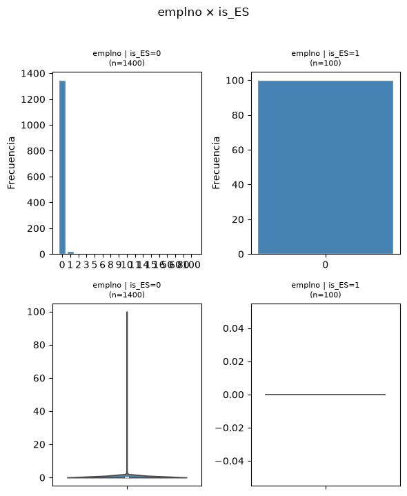
    


    
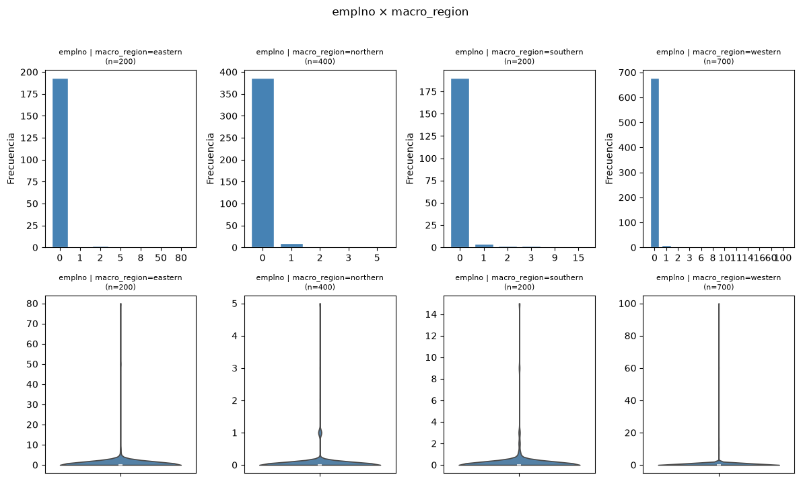
    


    
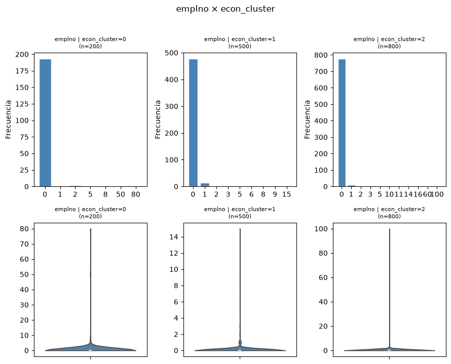
    


    
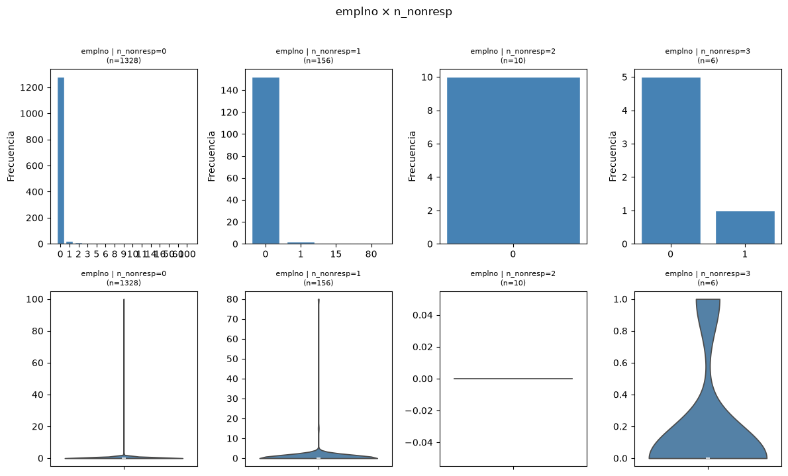
    


```python
------------------------------------------------------------------------------------------------------------
'emplno' - We can observe in the first group, how changes de distribution of emplno, when we only observe only on Spanish
samles. IN our 100 samples we cant see any respondent with employes. That means the predominant class for Spanish respondents are
wage employers or ppl without work/students.
        - In this dataset having employers is a minority.
        - Surprisingly the group who offer more respondents with employes its northern and southern region.
        - From the economic view, Econ cluster == 1 (The most common countries in the EU, like Spain, France or Great Britain.)
are who has more respondents with employes aswell.
        -Non respondent view doesnt give any clear correlation betwen groups and distributions.
------------------------------------------------------------------------------------------------------------
```


```python
multivariate_plot(df_71_clean, 'agea', group_cols)  
```


    
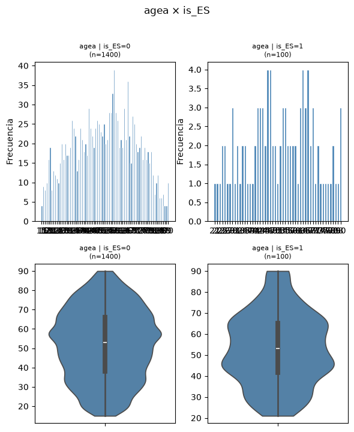
    


    
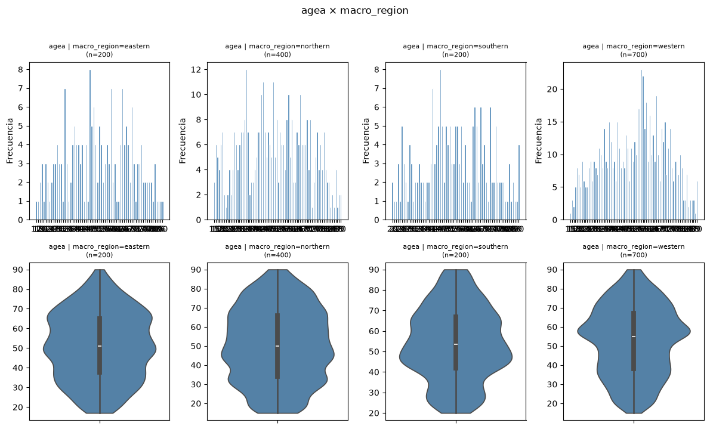
    


    
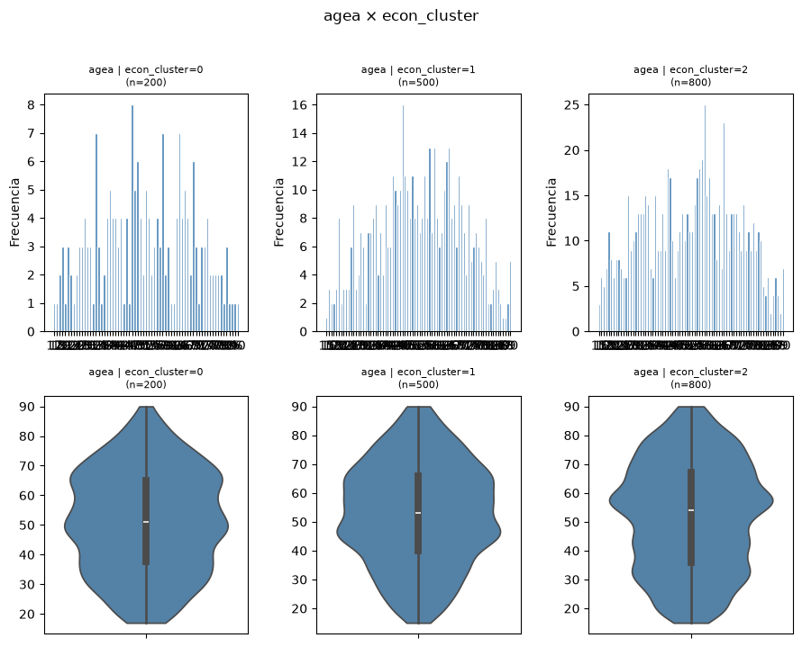
    


    
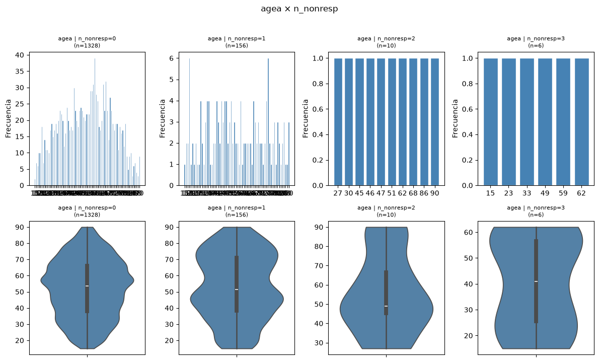
    


```python
------------------------------------------------------------------------------------------------------------
'agea' - In the first group comparison (Spanish or not) we can observe how the distribution changes from unimodal shape
around 60 years old to bimodality with low kurtosis(the density is well spread) exactly in the age of 35 and 66 years old.
        - The second observation group (macro regions) we can observe different density nodes between the groups, easter has 3 density
nodes on 35, 50 and 65 years old having a good wide representation. Norther is the most balanced between these subgroups. Having a
bit more density on 35 and 45 years old. Southern describes a low kurtosis on 48 years old age, meanwhile western does it around 58 years
old.
We just have 100 samples for each country, so is too quick to evaluate the whole dataset.
        - The third group, economy clusters, the poor ones follows similar graph than eastern macro region, the normal economy countries
has a good representation, having a bit more density on 48 years old, meanwhile rich countries(econ_cluster==2) their density node is around
58 years old, at the same time, its IQR is the most wide between the economic subgroups.
        -In the non response observation subgroups we can observe, that on people with 0 responses its age has a density node on 58 years
old, with an iqr a bit concentrated than non respone =1 having the median higher than the subgroup 2 wich has a bimodality or 2 high
density nodes on 75 years old and 45 years old. Anyways i think hasnt to much correlation because the ages of non respondent doesnt 
have any pattern , it changes totaly when n_nonresp increases.
------------------------------------------------------------------------------------------------------------
```


```python
------------------------------------------------------------------------------------------------------------
Lets study directly lrscale, due its high relation with non respone values.
------------------------------------------------------------------------------------------------------------
```


```python
multivariate_plot(df_71_clean, 'lrscale', group_cols)
```


    
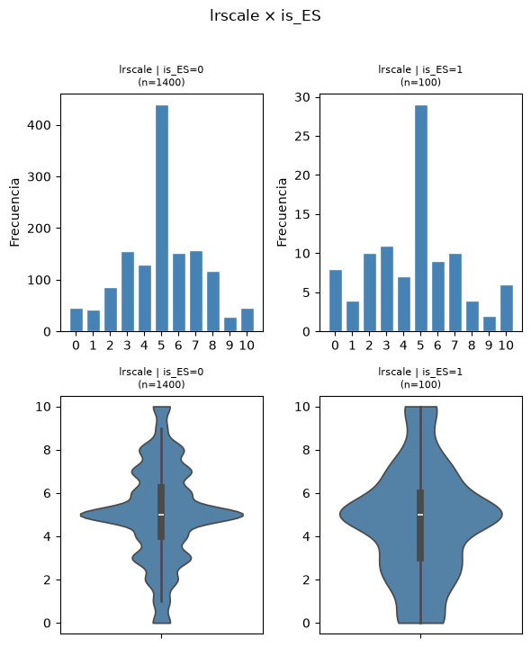
    


    
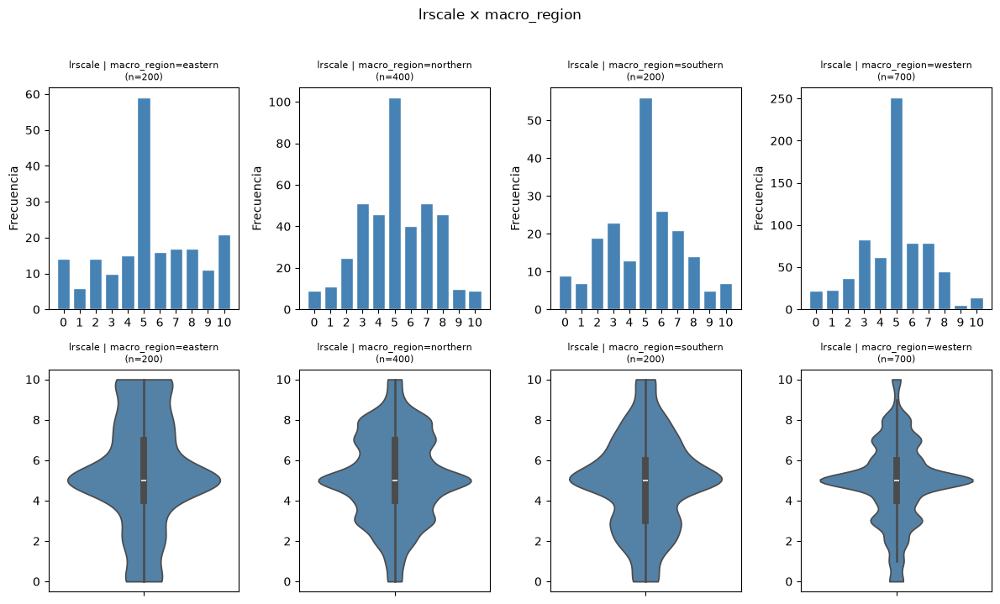
    


    
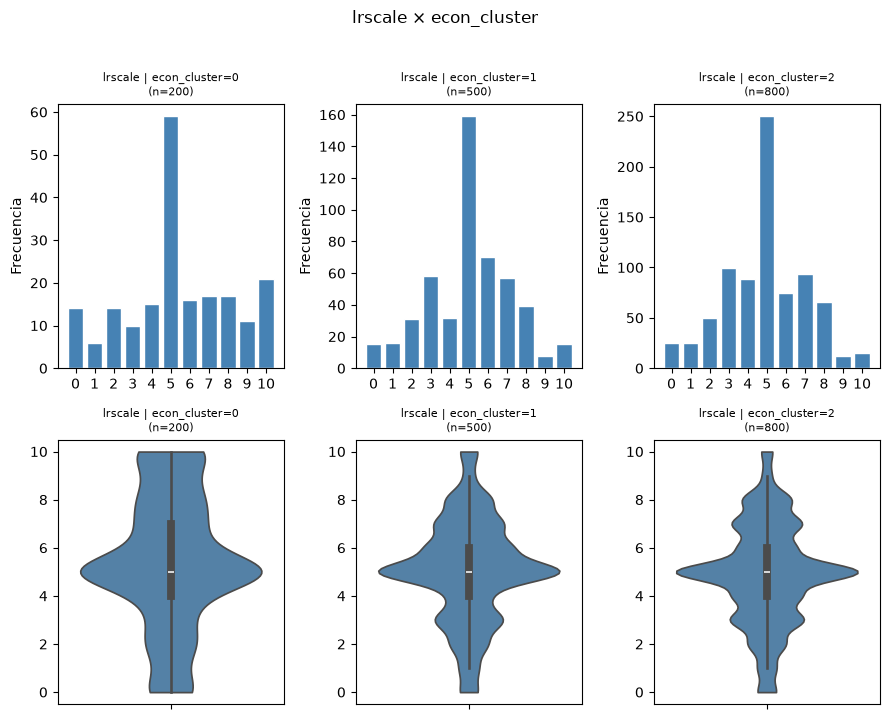
    


    
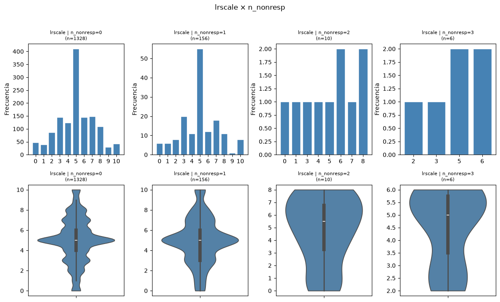
    


```python
------------------------------------------------------------------------------------------------------------
'lrscale' - In the first comparison group (Es=0/Es=1) we can observe how the denisity loses its mass on 5 value, spreading samples
in the whole range of the varible, its median is similar but iqr increases near to 3 unique value, means that spanish is more common to see
left winged respondents more than the common of the rest of Europe.
          - In the second groupd (macro regions) we can see how the distribution varies slightly in terms of density around the median,
there is a bit more of density on right wing respondents in Eastern countries, on Northern countries we see 2 extra density nodes on 3 and 8 lrscale values, 
in the southern macro region has a bit more density around 5 lrscale value in comparison with western values, wich has high density and kurtosis in 5 lrscale value.
          - In the third group (economic clusters) we can observe same pattern as macro regions, being the poors who got more representation on higher right wing ideology. 
The other 2 economic clusters follows a more limited density around 5 lrscale value, being the economic cluster 2 who has a greater kurtosis on this value.
          - In the non valid/responded group, we can observer , the higher non respond value the higher is the absence of lrscale values located near to 0 and 10.
------------------------------------------------------------------------------------------------------------          
```


```python
------------------------------------------------------------------------------------------------------------

4) Multicomparison, correlation matrix:
Spearmans rank correlation is used throughout because the majority of variables are ordinal (0-10 Likert scales),  categorical (one-hot encoded), 
or binary. Spearman operates on ranks, making it the natural choice for all three types simultaneously. 
The few remaining numeric variables (agea, emplno) do not require transformation, as Spearman internally converts them to ranks, treating them as ordinal by default.

------------------------------------------------------------------------------------------------------------       
```


```python
# One-hot there is no natural order between them.
region_dummies = pd.get_dummies(df_71_clean['macro_region'], prefix='region')
df_71_clean = pd.concat([df_71_clean.drop(columns=region_dummies.columns, errors='ignore'), region_dummies], axis=1)     
# → region_eastern, region_northern, region_southern, region_western   
#We can one-hot econ cluster also, but it has already natural order being 0 poor and 2 rich, it can be usefull for the feature engineering.

# Correlaction dataframe
corr_cols = ['agea', 'happy', 'lrscale', 'trstprl', 'trstlgl',
             'gdpcapitapct', 'ginicoefpct', 'inflationpct',
             'unemploymentpct', 'n_nonresp', 'econ_cluster','region_eastern','region_northern', 'region_southern','region_western'] 

corr = df_71_clean[corr_cols].corr(method='spearman')
```


```python
corr.style.background_gradient(cmap='RdBu_r', vmin=-1, vmax=1).format('{:.3f}').set_properties(**{'text-align': 'center', 'font-size': '11px'})
```


<style type="text/css">
#T_d57fb_row0_col0, #T_d57fb_row1_col1, #T_d57fb_row2_col2, #T_d57fb_row3_col3, #T_d57fb_row4_col4, #T_d57fb_row5_col5, #T_d57fb_row6_col6, #T_d57fb_row7_col7, #T_d57fb_row8_col8, #T_d57fb_row9_col9, #T_d57fb_row10_col10, #T_d57fb_row11_col11, #T_d57fb_row12_col12, #T_d57fb_row13_col13, #T_d57fb_row14_col14 {
  background-color: #67001f;
  color: #f1f1f1;
  text-align: center;
  font-size: 11px;
}
#T_d57fb_row0_col1, #T_d57fb_row1_col0, #T_d57fb_row3_col8, #T_d57fb_row8_col3 {
  background-color: #f8f2ef;
  color: #000000;
  text-align: center;
  font-size: 11px;
}
#T_d57fb_row0_col2, #T_d57fb_row1_col12, #T_d57fb_row2_col0, #T_d57fb_row12_col1 {
  background-color: #f9f0eb;
  color: #000000;
  text-align: center;
  font-size: 11px;
}
#T_d57fb_row0_col3, #T_d57fb_row0_col12, #T_d57fb_row1_col11, #T_d57fb_row2_col14, #T_d57fb_row3_col0, #T_d57fb_row11_col1, #T_d57fb_row12_col0, #T_d57fb_row14_col2 {
  background-color: #edf2f5;
  color: #000000;
  text-align: center;
  font-size: 11px;
}
#T_d57fb_row0_col4, #T_d57fb_row0_col11, #T_d57fb_row4_col0, #T_d57fb_row11_col0 {
  background-color: #f2f5f6;
  color: #000000;
  text-align: center;
  font-size: 11px;
}
#T_d57fb_row0_col5, #T_d57fb_row5_col0 {
  background-color: #f7f6f6;
  color: #000000;
  text-align: center;
  font-size: 11px;
}
#T_d57fb_row0_col6, #T_d57fb_row2_col11, #T_d57fb_row6_col0, #T_d57fb_row11_col2 {
  background-color: #f9efe9;
  color: #000000;
  text-align: center;
  font-size: 11px;
}
#T_d57fb_row0_col7, #T_d57fb_row7_col0, #T_d57fb_row7_col12, #T_d57fb_row12_col7 {
  background-color: #f0f4f6;
  color: #000000;
  text-align: center;
  font-size: 11px;
}
#T_d57fb_row0_col8, #T_d57fb_row0_col13, #T_d57fb_row2_col8, #T_d57fb_row2_col12, #T_d57fb_row4_col8, #T_d57fb_row8_col0, #T_d57fb_row8_col2, #T_d57fb_row8_col4, #T_d57fb_row12_col2, #T_d57fb_row13_col0 {
  background-color: #f8f3f0;
  color: #000000;
  text-align: center;
  font-size: 11px;
}
#T_d57fb_row0_col9, #T_d57fb_row0_col10, #T_d57fb_row1_col14, #T_d57fb_row4_col14, #T_d57fb_row9_col0, #T_d57fb_row9_col11, #T_d57fb_row10_col0, #T_d57fb_row11_col9, #T_d57fb_row14_col1, #T_d57fb_row14_col4 {
  background-color: #f7f5f4;
  color: #000000;
  text-align: center;
  font-size: 11px;
}
#T_d57fb_row0_col14, #T_d57fb_row2_col4, #T_d57fb_row4_col2, #T_d57fb_row14_col0 {
  background-color: #f8f1ed;
  color: #000000;
  text-align: center;
  font-size: 11px;
}
#T_d57fb_row1_col2, #T_d57fb_row2_col1 {
  background-color: #f9ede5;
  color: #000000;
  text-align: center;
  font-size: 11px;
}
#T_d57fb_row1_col3, #T_d57fb_row3_col1 {
  background-color: #fcdecd;
  color: #000000;
  text-align: center;
  font-size: 11px;
}
#T_d57fb_row1_col4, #T_d57fb_row4_col1 {
  background-color: #fddbc7;
  color: #000000;
  text-align: center;
  font-size: 11px;
}
#T_d57fb_row1_col5, #T_d57fb_row5_col1 {
  background-color: #fae9df;
  color: #000000;
  text-align: center;
  font-size: 11px;
}
#T_d57fb_row1_col6, #T_d57fb_row2_col5, #T_d57fb_row4_col9, #T_d57fb_row5_col2, #T_d57fb_row6_col1, #T_d57fb_row9_col4 {
  background-color: #e7f0f4;
  color: #000000;
  text-align: center;
  font-size: 11px;
}
#T_d57fb_row1_col7, #T_d57fb_row2_col9, #T_d57fb_row7_col1, #T_d57fb_row9_col2 {
  background-color: #f5f6f7;
  color: #000000;
  text-align: center;
  font-size: 11px;
}
#T_d57fb_row1_col8, #T_d57fb_row2_col7, #T_d57fb_row6_col7, #T_d57fb_row7_col2, #T_d57fb_row7_col6, #T_d57fb_row7_col9, #T_d57fb_row8_col1, #T_d57fb_row9_col7, #T_d57fb_row9_col14, #T_d57fb_row14_col9 {
  background-color: #f6f7f7;
  color: #000000;
  text-align: center;
  font-size: 11px;
}
#T_d57fb_row1_col9, #T_d57fb_row2_col10, #T_d57fb_row3_col14, #T_d57fb_row4_col7, #T_d57fb_row7_col4, #T_d57fb_row9_col1, #T_d57fb_row10_col2, #T_d57fb_row14_col3 {
  background-color: #eaf1f5;
  color: #000000;
  text-align: center;
  font-size: 11px;
}
#T_d57fb_row1_col10, #T_d57fb_row10_col1 {
  background-color: #fae8de;
  color: #000000;
  text-align: center;
  font-size: 11px;
}
#T_d57fb_row1_col13, #T_d57fb_row8_col10, #T_d57fb_row10_col8, #T_d57fb_row13_col1 {
  background-color: #eff3f5;
  color: #000000;
  text-align: center;
  font-size: 11px;
}
#T_d57fb_row2_col3, #T_d57fb_row3_col2 {
  background-color: #f9eee7;
  color: #000000;
  text-align: center;
  font-size: 11px;
}
#T_d57fb_row2_col6, #T_d57fb_row2_col13, #T_d57fb_row6_col2, #T_d57fb_row13_col2 {
  background-color: #f3f5f6;
  color: #000000;
  text-align: center;
  font-size: 11px;
}
#T_d57fb_row3_col4, #T_d57fb_row4_col3 {
  background-color: #d25849;
  color: #f1f1f1;
  text-align: center;
  font-size: 11px;
}
#T_d57fb_row3_col5, #T_d57fb_row5_col3 {
  background-color: #fddcc9;
  color: #000000;
  text-align: center;
  font-size: 11px;
}
#T_d57fb_row3_col6, #T_d57fb_row6_col3 {
  background-color: #bddbea;
  color: #000000;
  text-align: center;
  font-size: 11px;
}
#T_d57fb_row3_col7, #T_d57fb_row7_col3, #T_d57fb_row9_col10, #T_d57fb_row10_col9 {
  background-color: #e1edf3;
  color: #000000;
  text-align: center;
  font-size: 11px;
}
#T_d57fb_row3_col9, #T_d57fb_row9_col3 {
  background-color: #deebf2;
  color: #000000;
  text-align: center;
  font-size: 11px;
}
#T_d57fb_row3_col10, #T_d57fb_row10_col3 {
  background-color: #fbceb7;
  color: #000000;
  text-align: center;
  font-size: 11px;
}
#T_d57fb_row3_col11, #T_d57fb_row11_col3 {
  background-color: #e3edf3;
  color: #000000;
  text-align: center;
  font-size: 11px;
}
#T_d57fb_row3_col12, #T_d57fb_row4_col12, #T_d57fb_row12_col3, #T_d57fb_row12_col4 {
  background-color: #fac8af;
  color: #000000;
  text-align: center;
  font-size: 11px;
}
#T_d57fb_row3_col13, #T_d57fb_row6_col11, #T_d57fb_row11_col6, #T_d57fb_row13_col3 {
  background-color: #ddebf2;
  color: #000000;
  text-align: center;
  font-size: 11px;
}
#T_d57fb_row4_col5, #T_d57fb_row5_col4 {
  background-color: #fcd3bc;
  color: #000000;
  text-align: center;
  font-size: 11px;
}
#T_d57fb_row4_col6, #T_d57fb_row4_col13, #T_d57fb_row6_col4, #T_d57fb_row13_col4 {
  background-color: #d4e6f1;
  color: #000000;
  text-align: center;
  font-size: 11px;
}
#T_d57fb_row4_col10, #T_d57fb_row10_col4 {
  background-color: #f9c4a9;
  color: #000000;
  text-align: center;
  font-size: 11px;
}
#T_d57fb_row4_col11, #T_d57fb_row11_col4 {
  background-color: #d5e7f1;
  color: #000000;
  text-align: center;
  font-size: 11px;
}
#T_d57fb_row5_col6, #T_d57fb_row6_col5 {
  background-color: #a2cde3;
  color: #000000;
  text-align: center;
  font-size: 11px;
}
#T_d57fb_row5_col7, #T_d57fb_row7_col5 {
  background-color: #c0dceb;
  color: #000000;
  text-align: center;
  font-size: 11px;
}
#T_d57fb_row5_col8, #T_d57fb_row8_col5, #T_d57fb_row11_col12, #T_d57fb_row12_col11, #T_d57fb_row12_col13, #T_d57fb_row13_col12 {
  background-color: #c5dfec;
  color: #000000;
  text-align: center;
  font-size: 11px;
}
#T_d57fb_row5_col9, #T_d57fb_row9_col5 {
  background-color: #e6eff4;
  color: #000000;
  text-align: center;
  font-size: 11px;
}
#T_d57fb_row5_col10, #T_d57fb_row10_col5 {
  background-color: #930e26;
  color: #f1f1f1;
  text-align: center;
  font-size: 11px;
}
#T_d57fb_row5_col11, #T_d57fb_row11_col5 {
  background-color: #4695c4;
  color: #f1f1f1;
  text-align: center;
  font-size: 11px;
}
#T_d57fb_row5_col12, #T_d57fb_row12_col5 {
  background-color: #fbe4d6;
  color: #000000;
  text-align: center;
  font-size: 11px;
}
#T_d57fb_row5_col13, #T_d57fb_row8_col11, #T_d57fb_row11_col8, #T_d57fb_row11_col14, #T_d57fb_row13_col5, #T_d57fb_row13_col14, #T_d57fb_row14_col11, #T_d57fb_row14_col13 {
  background-color: #9dcbe1;
  color: #000000;
  text-align: center;
  font-size: 11px;
}
#T_d57fb_row5_col14, #T_d57fb_row14_col5 {
  background-color: #e17860;
  color: #f1f1f1;
  text-align: center;
  font-size: 11px;
}
#T_d57fb_row6_col8, #T_d57fb_row8_col6 {
  background-color: #fbe5d8;
  color: #000000;
  text-align: center;
  font-size: 11px;
}
#T_d57fb_row6_col9, #T_d57fb_row9_col6 {
  background-color: #fce2d2;
  color: #000000;
  text-align: center;
  font-size: 11px;
}
#T_d57fb_row6_col10, #T_d57fb_row10_col6 {
  background-color: #5fa5cd;
  color: #f1f1f1;
  text-align: center;
  font-size: 11px;
}
#T_d57fb_row6_col12, #T_d57fb_row12_col6 {
  background-color: #8ac0db;
  color: #000000;
  text-align: center;
  font-size: 11px;
}
#T_d57fb_row6_col13, #T_d57fb_row13_col6 {
  background-color: #e58368;
  color: #f1f1f1;
  text-align: center;
  font-size: 11px;
}
#T_d57fb_row6_col14, #T_d57fb_row14_col6 {
  background-color: #fbe6da;
  color: #000000;
  text-align: center;
  font-size: 11px;
}
#T_d57fb_row7_col8, #T_d57fb_row8_col7 {
  background-color: #93c6de;
  color: #000000;
  text-align: center;
  font-size: 11px;
}
#T_d57fb_row7_col10, #T_d57fb_row10_col7 {
  background-color: #81bad8;
  color: #000000;
  text-align: center;
  font-size: 11px;
}
#T_d57fb_row7_col11, #T_d57fb_row11_col7 {
  background-color: #d7634f;
  color: #f1f1f1;
  text-align: center;
  font-size: 11px;
}
#T_d57fb_row7_col13, #T_d57fb_row13_col7 {
  background-color: #c7e0ed;
  color: #000000;
  text-align: center;
  font-size: 11px;
}
#T_d57fb_row7_col14, #T_d57fb_row14_col7 {
  background-color: #cce2ef;
  color: #000000;
  text-align: center;
  font-size: 11px;
}
#T_d57fb_row8_col9, #T_d57fb_row9_col8 {
  background-color: #f8f4f2;
  color: #000000;
  text-align: center;
  font-size: 11px;
}
#T_d57fb_row8_col12, #T_d57fb_row12_col8 {
  background-color: #f5a886;
  color: #000000;
  text-align: center;
  font-size: 11px;
}
#T_d57fb_row8_col13, #T_d57fb_row13_col8 {
  background-color: #f2a17f;
  color: #000000;
  text-align: center;
  font-size: 11px;
}
#T_d57fb_row8_col14, #T_d57fb_row14_col8 {
  background-color: #9bc9e0;
  color: #000000;
  text-align: center;
  font-size: 11px;
}
#T_d57fb_row9_col12, #T_d57fb_row12_col9 {
  background-color: #e9f0f4;
  color: #000000;
  text-align: center;
  font-size: 11px;
}
#T_d57fb_row9_col13, #T_d57fb_row13_col9 {
  background-color: #faeae1;
  color: #000000;
  text-align: center;
  font-size: 11px;
}
#T_d57fb_row10_col11, #T_d57fb_row11_col10 {
  background-color: #3a87bd;
  color: #f1f1f1;
  text-align: center;
  font-size: 11px;
}
#T_d57fb_row10_col12, #T_d57fb_row12_col10 {
  background-color: #f9c2a7;
  color: #000000;
  text-align: center;
  font-size: 11px;
}
#T_d57fb_row10_col13, #T_d57fb_row13_col10 {
  background-color: #b1d5e7;
  color: #000000;
  text-align: center;
  font-size: 11px;
}
#T_d57fb_row10_col14, #T_d57fb_row14_col10 {
  background-color: #f4a683;
  color: #000000;
  text-align: center;
  font-size: 11px;
}
#T_d57fb_row11_col13, #T_d57fb_row13_col11 {
  background-color: #dae9f2;
  color: #000000;
  text-align: center;
  font-size: 11px;
}
#T_d57fb_row12_col14, #T_d57fb_row14_col12 {
  background-color: #4f9bc7;
  color: #f1f1f1;
  text-align: center;
  font-size: 11px;
}
</style>
<table id="T_d57fb">
  <thead>
    <tr>
      <th class="blank level0" >&nbsp;</th>
      <th id="T_d57fb_level0_col0" class="col_heading level0 col0" >agea</th>
      <th id="T_d57fb_level0_col1" class="col_heading level0 col1" >happy</th>
      <th id="T_d57fb_level0_col2" class="col_heading level0 col2" >lrscale</th>
      <th id="T_d57fb_level0_col3" class="col_heading level0 col3" >trstprl</th>
      <th id="T_d57fb_level0_col4" class="col_heading level0 col4" >trstlgl</th>
      <th id="T_d57fb_level0_col5" class="col_heading level0 col5" >gdpcapitapct</th>
      <th id="T_d57fb_level0_col6" class="col_heading level0 col6" >ginicoefpct</th>
      <th id="T_d57fb_level0_col7" class="col_heading level0 col7" >inflationpct</th>
      <th id="T_d57fb_level0_col8" class="col_heading level0 col8" >unemploymentpct</th>
      <th id="T_d57fb_level0_col9" class="col_heading level0 col9" >n_nonresp</th>
      <th id="T_d57fb_level0_col10" class="col_heading level0 col10" >econ_cluster</th>
      <th id="T_d57fb_level0_col11" class="col_heading level0 col11" >region_eastern</th>
      <th id="T_d57fb_level0_col12" class="col_heading level0 col12" >region_northern</th>
      <th id="T_d57fb_level0_col13" class="col_heading level0 col13" >region_southern</th>
      <th id="T_d57fb_level0_col14" class="col_heading level0 col14" >region_western</th>
    </tr>
  </thead>
  <tbody>
    <tr>
      <th id="T_d57fb_level0_row0" class="row_heading level0 row0" >agea</th>
      <td id="T_d57fb_row0_col0" class="data row0 col0" >1.000</td>
      <td id="T_d57fb_row0_col1" class="data row0 col1" >0.032</td>
      <td id="T_d57fb_row0_col2" class="data row0 col2" >0.054</td>
      <td id="T_d57fb_row0_col3" class="data row0 col3" >-0.053</td>
      <td id="T_d57fb_row0_col4" class="data row0 col4" >-0.027</td>
      <td id="T_d57fb_row0_col5" class="data row0 col5" >0.000</td>
      <td id="T_d57fb_row0_col6" class="data row0 col6" >0.060</td>
      <td id="T_d57fb_row0_col7" class="data row0 col7" >-0.036</td>
      <td id="T_d57fb_row0_col8" class="data row0 col8" >0.029</td>
      <td id="T_d57fb_row0_col9" class="data row0 col9" >0.012</td>
      <td id="T_d57fb_row0_col10" class="data row0 col10" >0.008</td>
      <td id="T_d57fb_row0_col11" class="data row0 col11" >-0.024</td>
      <td id="T_d57fb_row0_col12" class="data row0 col12" >-0.049</td>
      <td id="T_d57fb_row0_col13" class="data row0 col13" >0.029</td>
      <td id="T_d57fb_row0_col14" class="data row0 col14" >0.040</td>
    </tr>
    <tr>
      <th id="T_d57fb_level0_row1" class="row_heading level0 row1" >happy</th>
      <td id="T_d57fb_row1_col0" class="data row1 col0" >0.032</td>
      <td id="T_d57fb_row1_col1" class="data row1 col1" >1.000</td>
      <td id="T_d57fb_row1_col2" class="data row1 col2" >0.077</td>
      <td id="T_d57fb_row1_col3" class="data row1 col3" >0.174</td>
      <td id="T_d57fb_row1_col4" class="data row1 col4" >0.202</td>
      <td id="T_d57fb_row1_col5" class="data row1 col5" >0.094</td>
      <td id="T_d57fb_row1_col6" class="data row1 col6" >-0.086</td>
      <td id="T_d57fb_row1_col7" class="data row1 col7" >-0.013</td>
      <td id="T_d57fb_row1_col8" class="data row1 col8" >-0.003</td>
      <td id="T_d57fb_row1_col9" class="data row1 col9" >-0.069</td>
      <td id="T_d57fb_row1_col10" class="data row1 col10" >0.103</td>
      <td id="T_d57fb_row1_col11" class="data row1 col11" >-0.048</td>
      <td id="T_d57fb_row1_col12" class="data row1 col12" >0.053</td>
      <td id="T_d57fb_row1_col13" class="data row1 col13" >-0.044</td>
      <td id="T_d57fb_row1_col14" class="data row1 col14" >0.016</td>
    </tr>
    <tr>
      <th id="T_d57fb_level0_row2" class="row_heading level0 row2" >lrscale</th>
      <td id="T_d57fb_row2_col0" class="data row2 col0" >0.054</td>
      <td id="T_d57fb_row2_col1" class="data row2 col1" >0.077</td>
      <td id="T_d57fb_row2_col2" class="data row2 col2" >1.000</td>
      <td id="T_d57fb_row2_col3" class="data row2 col3" >0.063</td>
      <td id="T_d57fb_row2_col4" class="data row2 col4" >0.045</td>
      <td id="T_d57fb_row2_col5" class="data row2 col5" >-0.080</td>
      <td id="T_d57fb_row2_col6" class="data row2 col6" >-0.018</td>
      <td id="T_d57fb_row2_col7" class="data row2 col7" >-0.002</td>
      <td id="T_d57fb_row2_col8" class="data row2 col8" >0.027</td>
      <td id="T_d57fb_row2_col9" class="data row2 col9" >-0.012</td>
      <td id="T_d57fb_row2_col10" class="data row2 col10" >-0.068</td>
      <td id="T_d57fb_row2_col11" class="data row2 col11" >0.058</td>
      <td id="T_d57fb_row2_col12" class="data row2 col12" >0.026</td>
      <td id="T_d57fb_row2_col13" class="data row2 col13" >-0.019</td>
      <td id="T_d57fb_row2_col14" class="data row2 col14" >-0.050</td>
    </tr>
    <tr>
      <th id="T_d57fb_level0_row3" class="row_heading level0 row3" >trstprl</th>
      <td id="T_d57fb_row3_col0" class="data row3 col0" >-0.053</td>
      <td id="T_d57fb_row3_col1" class="data row3 col1" >0.174</td>
      <td id="T_d57fb_row3_col2" class="data row3 col2" >0.063</td>
      <td id="T_d57fb_row3_col3" class="data row3 col3" >1.000</td>
      <td id="T_d57fb_row3_col4" class="data row3 col4" >0.621</td>
      <td id="T_d57fb_row3_col5" class="data row3 col5" >0.191</td>
      <td id="T_d57fb_row3_col6" class="data row3 col6" >-0.258</td>
      <td id="T_d57fb_row3_col7" class="data row3 col7" >-0.113</td>
      <td id="T_d57fb_row3_col8" class="data row3 col8" >0.036</td>
      <td id="T_d57fb_row3_col9" class="data row3 col9" >-0.131</td>
      <td id="T_d57fb_row3_col10" class="data row3 col10" >0.244</td>
      <td id="T_d57fb_row3_col11" class="data row3 col11" >-0.106</td>
      <td id="T_d57fb_row3_col12" class="data row3 col12" >0.267</td>
      <td id="T_d57fb_row3_col13" class="data row3 col13" >-0.139</td>
      <td id="T_d57fb_row3_col14" class="data row3 col14" >-0.070</td>
    </tr>
    <tr>
      <th id="T_d57fb_level0_row4" class="row_heading level0 row4" >trstlgl</th>
      <td id="T_d57fb_row4_col0" class="data row4 col0" >-0.027</td>
      <td id="T_d57fb_row4_col1" class="data row4 col1" >0.202</td>
      <td id="T_d57fb_row4_col2" class="data row4 col2" >0.045</td>
      <td id="T_d57fb_row4_col3" class="data row4 col3" >0.621</td>
      <td id="T_d57fb_row4_col4" class="data row4 col4" >1.000</td>
      <td id="T_d57fb_row4_col5" class="data row4 col5" >0.230</td>
      <td id="T_d57fb_row4_col6" class="data row4 col6" >-0.183</td>
      <td id="T_d57fb_row4_col7" class="data row4 col7" >-0.064</td>
      <td id="T_d57fb_row4_col8" class="data row4 col8" >0.024</td>
      <td id="T_d57fb_row4_col9" class="data row4 col9" >-0.082</td>
      <td id="T_d57fb_row4_col10" class="data row4 col10" >0.283</td>
      <td id="T_d57fb_row4_col11" class="data row4 col11" >-0.178</td>
      <td id="T_d57fb_row4_col12" class="data row4 col12" >0.268</td>
      <td id="T_d57fb_row4_col13" class="data row4 col13" >-0.184</td>
      <td id="T_d57fb_row4_col14" class="data row4 col14" >0.009</td>
    </tr>
    <tr>
      <th id="T_d57fb_level0_row5" class="row_heading level0 row5" >gdpcapitapct</th>
      <td id="T_d57fb_row5_col0" class="data row5 col0" >0.000</td>
      <td id="T_d57fb_row5_col1" class="data row5 col1" >0.094</td>
      <td id="T_d57fb_row5_col2" class="data row5 col2" >-0.080</td>
      <td id="T_d57fb_row5_col3" class="data row5 col3" >0.191</td>
      <td id="T_d57fb_row5_col4" class="data row5 col4" >0.230</td>
      <td id="T_d57fb_row5_col5" class="data row5 col5" >1.000</td>
      <td id="T_d57fb_row5_col6" class="data row5 col6" >-0.349</td>
      <td id="T_d57fb_row5_col7" class="data row5 col7" >-0.257</td>
      <td id="T_d57fb_row5_col8" class="data row5 col8" >-0.239</td>
      <td id="T_d57fb_row5_col9" class="data row5 col9" >-0.090</td>
      <td id="T_d57fb_row5_col10" class="data row5 col10" >0.876</td>
      <td id="T_d57fb_row5_col11" class="data row5 col11" >-0.590</td>
      <td id="T_d57fb_row5_col12" class="data row5 col12" >0.140</td>
      <td id="T_d57fb_row5_col13" class="data row5 col13" >-0.363</td>
      <td id="T_d57fb_row5_col14" class="data row5 col14" >0.526</td>
    </tr>
    <tr>
      <th id="T_d57fb_level0_row6" class="row_heading level0 row6" >ginicoefpct</th>
      <td id="T_d57fb_row6_col0" class="data row6 col0" >0.060</td>
      <td id="T_d57fb_row6_col1" class="data row6 col1" >-0.086</td>
      <td id="T_d57fb_row6_col2" class="data row6 col2" >-0.018</td>
      <td id="T_d57fb_row6_col3" class="data row6 col3" >-0.258</td>
      <td id="T_d57fb_row6_col4" class="data row6 col4" >-0.183</td>
      <td id="T_d57fb_row6_col5" class="data row6 col5" >-0.349</td>
      <td id="T_d57fb_row6_col6" class="data row6 col6" >1.000</td>
      <td id="T_d57fb_row6_col7" class="data row6 col7" >-0.005</td>
      <td id="T_d57fb_row6_col8" class="data row6 col8" >0.128</td>
      <td id="T_d57fb_row6_col9" class="data row6 col9" >0.150</td>
      <td id="T_d57fb_row6_col10" class="data row6 col10" >-0.525</td>
      <td id="T_d57fb_row6_col11" class="data row6 col11" >-0.136</td>
      <td id="T_d57fb_row6_col12" class="data row6 col12" >-0.419</td>
      <td id="T_d57fb_row6_col13" class="data row6 col13" >0.500</td>
      <td id="T_d57fb_row6_col14" class="data row6 col14" >0.124</td>
    </tr>
    <tr>
      <th id="T_d57fb_level0_row7" class="row_heading level0 row7" >inflationpct</th>
      <td id="T_d57fb_row7_col0" class="data row7 col0" >-0.036</td>
      <td id="T_d57fb_row7_col1" class="data row7 col1" >-0.013</td>
      <td id="T_d57fb_row7_col2" class="data row7 col2" >-0.002</td>
      <td id="T_d57fb_row7_col3" class="data row7 col3" >-0.113</td>
      <td id="T_d57fb_row7_col4" class="data row7 col4" >-0.064</td>
      <td id="T_d57fb_row7_col5" class="data row7 col5" >-0.257</td>
      <td id="T_d57fb_row7_col6" class="data row7 col6" >-0.005</td>
      <td id="T_d57fb_row7_col7" class="data row7 col7" >1.000</td>
      <td id="T_d57fb_row7_col8" class="data row7 col8" >-0.397</td>
      <td id="T_d57fb_row7_col9" class="data row7 col9" >-0.005</td>
      <td id="T_d57fb_row7_col10" class="data row7 col10" >-0.438</td>
      <td id="T_d57fb_row7_col11" class="data row7 col11" >0.590</td>
      <td id="T_d57fb_row7_col12" class="data row7 col12" >-0.035</td>
      <td id="T_d57fb_row7_col13" class="data row7 col13" >-0.227</td>
      <td id="T_d57fb_row7_col14" class="data row7 col14" >-0.217</td>
    </tr>
    <tr>
      <th id="T_d57fb_level0_row8" class="row_heading level0 row8" >unemploymentpct</th>
      <td id="T_d57fb_row8_col0" class="data row8 col0" >0.029</td>
      <td id="T_d57fb_row8_col1" class="data row8 col1" >-0.003</td>
      <td id="T_d57fb_row8_col2" class="data row8 col2" >0.027</td>
      <td id="T_d57fb_row8_col3" class="data row8 col3" >0.036</td>
      <td id="T_d57fb_row8_col4" class="data row8 col4" >0.024</td>
      <td id="T_d57fb_row8_col5" class="data row8 col5" >-0.239</td>
      <td id="T_d57fb_row8_col6" class="data row8 col6" >0.128</td>
      <td id="T_d57fb_row8_col7" class="data row8 col7" >-0.397</td>
      <td id="T_d57fb_row8_col8" class="data row8 col8" >1.000</td>
      <td id="T_d57fb_row8_col9" class="data row8 col9" >0.018</td>
      <td id="T_d57fb_row8_col10" class="data row8 col10" >-0.044</td>
      <td id="T_d57fb_row8_col11" class="data row8 col11" >-0.363</td>
      <td id="T_d57fb_row8_col12" class="data row8 col12" >0.384</td>
      <td id="T_d57fb_row8_col13" class="data row8 col13" >0.409</td>
      <td id="T_d57fb_row8_col14" class="data row8 col14" >-0.371</td>
    </tr>
    <tr>
      <th id="T_d57fb_level0_row9" class="row_heading level0 row9" >n_nonresp</th>
      <td id="T_d57fb_row9_col0" class="data row9 col0" >0.012</td>
      <td id="T_d57fb_row9_col1" class="data row9 col1" >-0.069</td>
      <td id="T_d57fb_row9_col2" class="data row9 col2" >-0.012</td>
      <td id="T_d57fb_row9_col3" class="data row9 col3" >-0.131</td>
      <td id="T_d57fb_row9_col4" class="data row9 col4" >-0.082</td>
      <td id="T_d57fb_row9_col5" class="data row9 col5" >-0.090</td>
      <td id="T_d57fb_row9_col6" class="data row9 col6" >0.150</td>
      <td id="T_d57fb_row9_col7" class="data row9 col7" >-0.005</td>
      <td id="T_d57fb_row9_col8" class="data row9 col8" >0.018</td>
      <td id="T_d57fb_row9_col9" class="data row9 col9" >1.000</td>
      <td id="T_d57fb_row9_col10" class="data row9 col10" >-0.113</td>
      <td id="T_d57fb_row9_col11" class="data row9 col11" >0.012</td>
      <td id="T_d57fb_row9_col12" class="data row9 col12" >-0.075</td>
      <td id="T_d57fb_row9_col13" class="data row9 col13" >0.092</td>
      <td id="T_d57fb_row9_col14" class="data row9 col14" >-0.004</td>
    </tr>
    <tr>
      <th id="T_d57fb_level0_row10" class="row_heading level0 row10" >econ_cluster</th>
      <td id="T_d57fb_row10_col0" class="data row10 col0" >0.008</td>
      <td id="T_d57fb_row10_col1" class="data row10 col1" >0.103</td>
      <td id="T_d57fb_row10_col2" class="data row10 col2" >-0.068</td>
      <td id="T_d57fb_row10_col3" class="data row10 col3" >0.244</td>
      <td id="T_d57fb_row10_col4" class="data row10 col4" >0.283</td>
      <td id="T_d57fb_row10_col5" class="data row10 col5" >0.876</td>
      <td id="T_d57fb_row10_col6" class="data row10 col6" >-0.525</td>
      <td id="T_d57fb_row10_col7" class="data row10 col7" >-0.438</td>
      <td id="T_d57fb_row10_col8" class="data row10 col8" >-0.044</td>
      <td id="T_d57fb_row10_col9" class="data row10 col9" >-0.113</td>
      <td id="T_d57fb_row10_col10" class="data row10 col10" >1.000</td>
      <td id="T_d57fb_row10_col11" class="data row10 col11" >-0.655</td>
      <td id="T_d57fb_row10_col12" class="data row10 col12" >0.290</td>
      <td id="T_d57fb_row10_col13" class="data row10 col13" >-0.302</td>
      <td id="T_d57fb_row10_col14" class="data row10 col14" >0.395</td>
    </tr>
    <tr>
      <th id="T_d57fb_level0_row11" class="row_heading level0 row11" >region_eastern</th>
      <td id="T_d57fb_row11_col0" class="data row11 col0" >-0.024</td>
      <td id="T_d57fb_row11_col1" class="data row11 col1" >-0.048</td>
      <td id="T_d57fb_row11_col2" class="data row11 col2" >0.058</td>
      <td id="T_d57fb_row11_col3" class="data row11 col3" >-0.106</td>
      <td id="T_d57fb_row11_col4" class="data row11 col4" >-0.178</td>
      <td id="T_d57fb_row11_col5" class="data row11 col5" >-0.590</td>
      <td id="T_d57fb_row11_col6" class="data row11 col6" >-0.136</td>
      <td id="T_d57fb_row11_col7" class="data row11 col7" >0.590</td>
      <td id="T_d57fb_row11_col8" class="data row11 col8" >-0.363</td>
      <td id="T_d57fb_row11_col9" class="data row11 col9" >0.012</td>
      <td id="T_d57fb_row11_col10" class="data row11 col10" >-0.655</td>
      <td id="T_d57fb_row11_col11" class="data row11 col11" >1.000</td>
      <td id="T_d57fb_row11_col12" class="data row11 col12" >-0.237</td>
      <td id="T_d57fb_row11_col13" class="data row11 col13" >-0.154</td>
      <td id="T_d57fb_row11_col14" class="data row11 col14" >-0.367</td>
    </tr>
    <tr>
      <th id="T_d57fb_level0_row12" class="row_heading level0 row12" >region_northern</th>
      <td id="T_d57fb_row12_col0" class="data row12 col0" >-0.049</td>
      <td id="T_d57fb_row12_col1" class="data row12 col1" >0.053</td>
      <td id="T_d57fb_row12_col2" class="data row12 col2" >0.026</td>
      <td id="T_d57fb_row12_col3" class="data row12 col3" >0.267</td>
      <td id="T_d57fb_row12_col4" class="data row12 col4" >0.268</td>
      <td id="T_d57fb_row12_col5" class="data row12 col5" >0.140</td>
      <td id="T_d57fb_row12_col6" class="data row12 col6" >-0.419</td>
      <td id="T_d57fb_row12_col7" class="data row12 col7" >-0.035</td>
      <td id="T_d57fb_row12_col8" class="data row12 col8" >0.384</td>
      <td id="T_d57fb_row12_col9" class="data row12 col9" >-0.075</td>
      <td id="T_d57fb_row12_col10" class="data row12 col10" >0.290</td>
      <td id="T_d57fb_row12_col11" class="data row12 col11" >-0.237</td>
      <td id="T_d57fb_row12_col12" class="data row12 col12" >1.000</td>
      <td id="T_d57fb_row12_col13" class="data row12 col13" >-0.237</td>
      <td id="T_d57fb_row12_col14" class="data row12 col14" >-0.564</td>
    </tr>
    <tr>
      <th id="T_d57fb_level0_row13" class="row_heading level0 row13" >region_southern</th>
      <td id="T_d57fb_row13_col0" class="data row13 col0" >0.029</td>
      <td id="T_d57fb_row13_col1" class="data row13 col1" >-0.044</td>
      <td id="T_d57fb_row13_col2" class="data row13 col2" >-0.019</td>
      <td id="T_d57fb_row13_col3" class="data row13 col3" >-0.139</td>
      <td id="T_d57fb_row13_col4" class="data row13 col4" >-0.184</td>
      <td id="T_d57fb_row13_col5" class="data row13 col5" >-0.363</td>
      <td id="T_d57fb_row13_col6" class="data row13 col6" >0.500</td>
      <td id="T_d57fb_row13_col7" class="data row13 col7" >-0.227</td>
      <td id="T_d57fb_row13_col8" class="data row13 col8" >0.409</td>
      <td id="T_d57fb_row13_col9" class="data row13 col9" >0.092</td>
      <td id="T_d57fb_row13_col10" class="data row13 col10" >-0.302</td>
      <td id="T_d57fb_row13_col11" class="data row13 col11" >-0.154</td>
      <td id="T_d57fb_row13_col12" class="data row13 col12" >-0.237</td>
      <td id="T_d57fb_row13_col13" class="data row13 col13" >1.000</td>
      <td id="T_d57fb_row13_col14" class="data row13 col14" >-0.367</td>
    </tr>
    <tr>
      <th id="T_d57fb_level0_row14" class="row_heading level0 row14" >region_western</th>
      <td id="T_d57fb_row14_col0" class="data row14 col0" >0.040</td>
      <td id="T_d57fb_row14_col1" class="data row14 col1" >0.016</td>
      <td id="T_d57fb_row14_col2" class="data row14 col2" >-0.050</td>
      <td id="T_d57fb_row14_col3" class="data row14 col3" >-0.070</td>
      <td id="T_d57fb_row14_col4" class="data row14 col4" >0.009</td>
      <td id="T_d57fb_row14_col5" class="data row14 col5" >0.526</td>
      <td id="T_d57fb_row14_col6" class="data row14 col6" >0.124</td>
      <td id="T_d57fb_row14_col7" class="data row14 col7" >-0.217</td>
      <td id="T_d57fb_row14_col8" class="data row14 col8" >-0.371</td>
      <td id="T_d57fb_row14_col9" class="data row14 col9" >-0.004</td>
      <td id="T_d57fb_row14_col10" class="data row14 col10" >0.395</td>
      <td id="T_d57fb_row14_col11" class="data row14 col11" >-0.367</td>
      <td id="T_d57fb_row14_col12" class="data row14 col12" >-0.564</td>
      <td id="T_d57fb_row14_col13" class="data row14 col13" >-0.367</td>
      <td id="T_d57fb_row14_col14" class="data row14 col14" >1.000</td>
    </tr>
  </tbody>
</table>


```python
------------------------------------------------------------------------------------------------------------
Lets make a breaf analysis by semantic variable blocks:

- Trust block:
"Trust in parliament and trust in the legal system are strongly correlated (ρ = 0.63), forming a coherent institutional trust block. 
"Neither ideological position (ρ = 0.06), 
"subjective well-being (ρ = 0.05), nor age (ρ = −0.05) show meaningful association with institutional trust in this sample."

- Trust block - Macroeconomic Variables:
"Among macroeconomic variables, the Gini coefficient is the strongest predictor of institutional trust (ρ = −0.26 for parliament, −0.18 for legal system), 
"followed by GDP per capita (ρ = 0.19 / 0.23). Unemployment shows no meaningful association (ρ ≈ 0.03), suggesting that institutional trust is driven by 
"the level and distribution of wealth rather than labor market conditions."

- Trust block - Macro Region dummies:
"The northern region shows the highest association with institutional trust (ρ = 0.27), while southern, eastern, and western regions show negative or null associations.
"However, the northern region's correlation is nearly identical to the economic cluster's (ρ = 0.24–0.28), 
"indicating that the 'Nordic effect' is largely an economic effect rather than a distinct institutional or cultural one."

- Quality  Response block:
"Response completeness shows a weak negative association with trust in parliament (ρ = −0.13), 
"confirming that non-respondents are not a random subset: they tend to be less trusting. 
"This validates the need for the n_nonresp control variable in the predictive model."

- Macroeconomic (group and individual) block:
"
| Pair                             | r          | Interpretation              |
| -------------------------------- | ---------- | ----------------------------|
| `gdpcapitapct ↔ ginicoefpct`     | −0.349     | More PIB → less inequality. |
| `gdpcapitapct ↔ inflationpct`    | −0.257     | More PIB → less inflation.  |
| `inflationpct ↔ unemploymentpct` | **−0.397** | Phillips in cross section.  |
| `gdpcapitapct ↔ unemploymentpct` | −0.240     | More PIB → less unemployment|
"
- Macroeconomic cluster - Macro region (redundance):
"
|                                  |            |                |
| -------------------------------- | ---------- | -------------- |
| Pair                             | r          | Interpretation |
| `region_northern ↔ econ_cluster` | 0.290      | Moderate.      |
| `region_southern ↔ econ_cluster` | −0.302     | Moderate.      |
| `region_western ↔ econ_cluster`  | 0.395      | Moderate-high. |
| `region_eastern ↔ econ_cluster`  | **−0.655** | Strong.        |
"
- In this exercise the next feautures would be my set for the prediction model:
"
| Feature           | r con trstprl | Decission                                 |
| ----------------- | ------------- | ----------------------------------------- |
| `trstlgl`         | 0.628         | **Target**                                |
| `gdpcapitapct`    | 0.190         | ✓ Feature                                 |
| `ginicoefpct`     | −0.259        | ✓ Feature                                 |
| `econ_cluster`    | 0.242         | ✓ Feature                                 |
| `region_northern` | 0.268         | ✓ Feature                                 |
| `region_southern` | −0.136        | ✓ Feature                                 |
| `n_nonresp`       | −0.131        | ✓ Control                                 |
| `unemploymentpct` | 0.038         | ✗ Discard                                 |
| `inflationpct`    | −0.113        | ✗ Discard  (weak, and colineal with GDP)  |
| `lrscale`         | 0.058         | ✗ Discard                                 |
| `happy`           | 0.048         | ✗ Discard                                 |
| `agea`            | −0.050        | ✗ Discard                                 |
| `region_eastern`  | −0.106        | ✗ Redundant with econ_cluster (−0.655)    |
| `region_western`  | −0.073        | ✗ Null                                    |
"
----------------------------------------------------------------------------------------------------------
```
